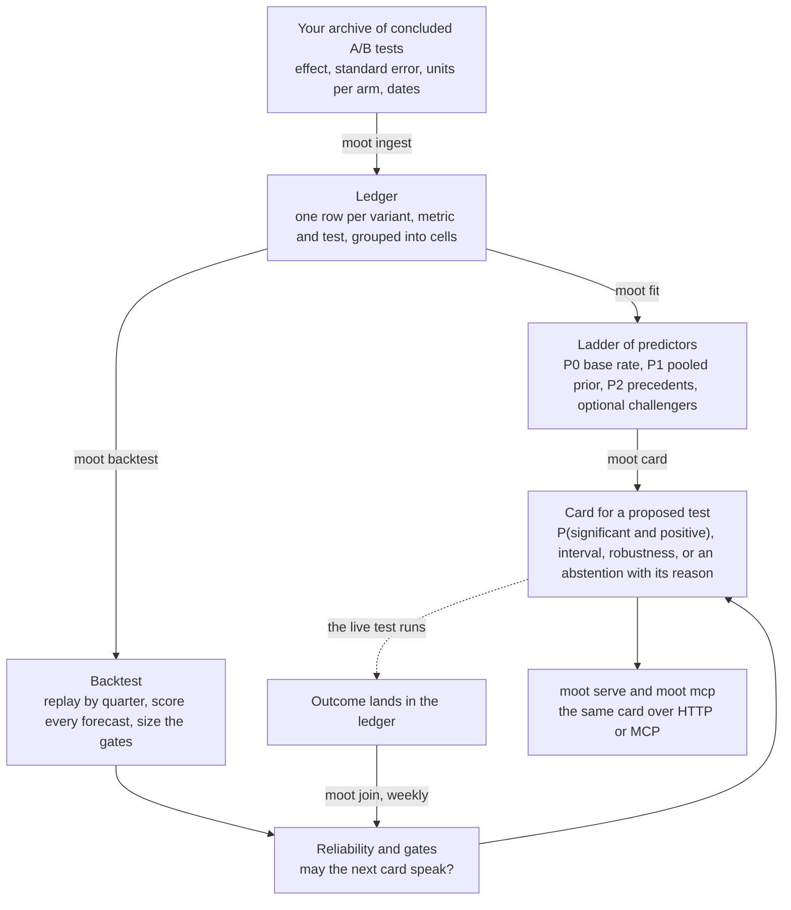
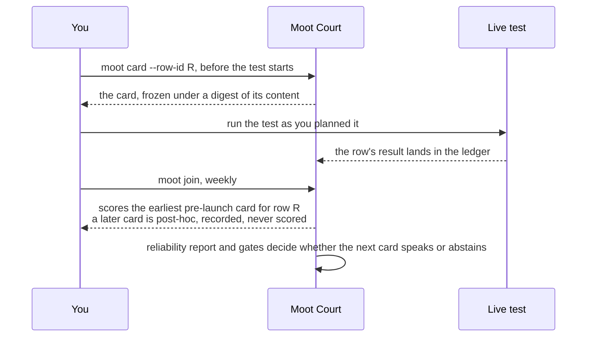

# Moot Court

**Forecast the next A/B test from the tests you already ran, and know when that record says too little.**

Most A/B tests end flat. Before you spend traffic on the next one, Moot Court tells you how often tests like it ended significant in your own history and what range of effects to expect. It keeps a frozen record of every forecast, so you can check later whether the forecasts were any good.

Moot Court is a command-line tool (`moot`), installed as a Python package.

- **You give it** a table of your concluded tests. Each row needs only aggregates: the effect, its standard error, the units per arm and the dates. It never needs user-level data.
- **You get back** a **card**: a one-page forecast for one proposed test. Its main lines look like this:

```text
- Base rate of significant positive results in the cell (P0): 0.042
- P(significant and positive): 0.052
- 80 percent interval for the true effect: -0.06 to 0.01 units of the ledger's effect
- Status: issue
```

Here the chance of a significant win is 5 percent, against 4 percent for past tests of this kind: no reason to expect more than usual. When your history is too thin or too different to support a forecast, the card abstains and says why.

The card is advice before launch. The live test decides. Moot Court never changes the decision to launch, the traffic split or when a test stops.

**Status: research software.** In our study of 2,949 public headline tests, it predicted the spread of results better than the historical win rate, but not which test would win. A result on headline tests does not transfer automatically to product deployments, which the study did not test. Expect to need a few hundred concluded tests of one kind before the tool can show whether its forecasts beat your own win rate; below that, it says so. Read the [results and limits](#what-the-results-show-and-what-the-project-does-not-show) before you rely on it.

**Contents:** [How it fits together](#how-it-fits-together) | [Quickstart](#quickstart) | [Reading a card](#reading-a-card) | [The weekly loop](#the-weekly-loop) | [The ladder of predictors](#the-ladder-of-predictors) | [What the results show](#what-the-results-show-and-what-the-project-does-not-show) | [Learn more](#learn-more) | [More you can do](#more-you-can-do) | [License and data](#license-and-data) | [Citing](#citing)

## How it fits together



Five ideas carry the whole package.

| Idea | What it is |
|---|---|
| **Ledger** | The table of your concluded experiments: one row per variant, per metric, per experiment. One command imports results. A row that fails a quality rule is kept and counted but does not teach the models. |
| **Cell** | A group of experiments forecast together, by default one per metric. Every forecast is made inside one cell. |
| **Card** | The forecast for one proposed experiment: the chance that it ends significant and positive, an interval for the true effect and how robust that opinion is. A card can abstain, and then it says why. Each card is stored with a digest of its content, so any later edit is detectable. |
| **Backtest** | A replay of the ledger quarter by quarter: forecast every past experiment from the results that were final before it started, then score the forecast. It says whether the cards can be trusted. |
| **Gate** | The number of scored tests needed before a claim of skill can be made. Below it, the backtest and the card report "undecidable at this n". |

## Quickstart

The quickstart runs on a synthetic sample, so you need no data of your own. It takes about two minutes.

**Requirements.** Python 3.11 or newer. Keep the clone and its environment on your internal disk, not on an external volume ([why](docs/troubleshooting.md#working-from-a-clone-on-an-exfat-volume)).

**1. Install.** Clone the repository, then make and activate an environment and install the package:

```bash
git clone https://github.com/journey-agents/mootcourt.git && cd mootcourt
python3 -m venv .venv && source .venv/bin/activate
pip install -e .
```

With `uv`, run `uv sync --all-extras` in the clone instead. Outside the clone, either activate that environment or write `uv run --project /path/to/clone moot ...` wherever the commands below say `moot ...`.

**2. Create a project** next to the clone, not inside it. `moot init` writes the settings, the data folders, a synthetic sample ledger and a quick gates file (about 30 seconds):

```bash run quiet
mkdir moot-demo && cd moot-demo
moot init
```

**3. Import and fit** (5 to 15 seconds). `ingest` reports how many rows were admitted to teach the models:

```bash run
moot ingest --format generic --input mootcourt-data/data/sample-ledger.csv --source-name sample
moot fit --source sample
```

```text output
360 rows from 120 experiments
  admitted: 360
admitted by cell: checkout_conversion 120, pages_per_session 120, revenue_per_user 120
final reads from 2023-01-23 to 2025-12-29
snapshot 20261105-b04b5b1dd18c for sample
ledger ~/moot-demo/mootcourt-data/data/ledger/ledger.parquet: 360 rows
fitted model 6b43ae900d91 at snapshot 20261105-b04b5b1dd18c on 360 rows usable at 2026-11-05T15:36:20.949406+00:00 in 1.3 s; it is the champion for sample
no backtest exists for this snapshot, so the backtest summary slot is empty; run `moot backtest` then `moot fit`
```

The ids contain the date of the import, so yours will differ. The last line of `fit` is expected: the new model has no backtest yet, and the next step fills that slot.

**4. Backtest** (about 20 seconds). This is the step that says whether to trust a card:

```bash run quiet
moot backtest --source sample
```

The command prints the paths of the report it wrote. Open the `.md` file. On this synthetic sample the forecasts do not beat the base rate, by design, and the first table reads "undecidable at this n": the 110 scored tests are below the gate of 175. That is the right reading of a sample with no structure.

**5. Ask for a card** (about a second). The sample is static, so `--now` issues the card as of the end of its history. On a live ledger you leave `--now` out:

```bash run
moot card --source sample --cell checkout_conversion --impressions 20000 --now 2025-12-30T00:00:00+00:00
```

```text output
# Moot Court card

- Card id: 75e9856f63b7e30a
- Source: sample
- Cell: checkout_conversion
- Origin: 2025-12-30T00:00:00+00:00
- Ledger snapshot: 20261105-b04b5b1dd18c
- Model: 6b43ae900d91
- Feature hash: e7ee5b832720
- Issued at: 2025-12-30T00:00:00+00:00
- Request: planned units per arm: 20000, standard error of the future estimate: 0.015 units of the ledger's effect

## Evidence

- Admitted rows in the cell visible at the origin: 120
- Effective number of precedents: 119.3
- Base rate of significant positive results in the cell (P0): 0.042

## Prediction

- P(significant and positive): 0.052
- Point estimate: -0.03 units of the ledger's effect
- 80 percent interval for the true effect: -0.06 to 0.01 units of the ledger's effect
- 80 percent interval for the result of the test at the planned standard error: -0.07 to 0.02 units of the ledger's effect
- P(true effect above 0): 0.200
- Rung: P2, weight on precedents 0.0

## Team forecast

- None provided.

## Robustness

- Not applicable: the weight on precedents is zero, so the card uses the cell prior and no precedent can change it.

## Skill at this n

- Latest gated backtest, pooled over all cells because this cell's own figure is undecidable at this n (at this cell's own dependence the gate needs 463 tests for a skill of 0.20 and 661 for 0.10; it has 110), rung P2: Brier skill 0.020 (90 percent interval 0.000 to 0.038) over 110 tests
- Brier skill against the cell base rate, trailing 8 weeks: 0.100 (90 percent interval -5.280 to 0.123, by test), measured on 7 rows from 7 tests, as of 2025-12-29T00:00:00+00:00, descriptive, one window of many
- Gate at this n: 7 tests: undecidable at this n (the gate needs 250 tests for a skill of 0.10 and 175 for 0.20 at the nearest simulated base rate, 0.09 (this cell's own rate is 0.042)), and its interval includes zero

## Abstention

- Status: issue
- Reasons: none

---

The card is advice before launch. The live test decides. Moot Court never changes the decision to launch, the traffic split or when a test stops.
```

The card reads "Status: issue" although its skill line says "undecidable at this n". The two are separate. The gate says whether the record is large enough to judge the forecasts. The card abstains only for one of four reasons: too few past tests in the cell, a proposal unlike anything in the record, a missing or stale reliability report, or a forecast that changes when the precedents are resampled.

[Tutorial 1](docs/tutorials/01-first-card.md) continues from here: it explains each line and checks the setup with `moot doctor`.

## Reading a card

1. **Abstention** first. If the card declines, it says why, and nothing below it is an opinion.
2. **`P(significant and positive)`**, read against the cell's base rate: the chance that the live test will show a significant positive estimate.
3. **`P(true effect above 0)`**: the chance that the true effect is positive, whatever the test shows.
4. **The intervals**, one for the true effect and one for the result the test will show at the planned standard error. They are in the units your ledger records effects in.
5. **Skill at this n**, the card's own record: how forecasts like it did recently and in the backtest, with intervals and the gate verdict.

## The weekly loop

A weekly step joins each concluded experiment to the card that forecast it. The record of hits and misses decides whether the next card may speak.



To have a card scored, name the ledger row it forecasts: give `moot card` a row id with `--row-id` (or `--test-id` with `--variant-id`). Only a card issued before its test started counts as evidence, and a row is scored once, by its earliest such card. The [concepts page](docs/concepts.md) has the details and the glossary.

## The ladder of predictors

A **rung** is one predictor in a ladder from simple to richer. A card says which rung produced it, and the backtest scores every rung.

| Rung | In plain words | What it adds |
|---|---|---|
| **P0** | The historical win rate of the cell | The empirical base rate, the reference that every other rung is scored against |
| **P1** | A statistical summary of the cell's past effects | A partially pooled Student-t prior that accounts for measurement error |
| **P2** | P1 moved toward similar past tests, called precedents | Kernel-weighted precedents under an admission guard. At a weight of zero on precedents P2 reduces to P1 exactly |
| Challengers | Three learned models, for comparison only | A gradient-boosted regressor, a local empirical Bayes rung and a text classifier: `moot backtest --source sample --challenger gbm` |

In one sentence: P1 adds a fitted prior, and P2 adds kernel-weighted precedents under an admission guard. The guard lets precedents carry weight only when they improve held-out forecasts by more than two standard errors. It guards against fitting noise and is not a promise that P2 beats P1 on later tests. The [results page](docs/results.md) shows guarded and unguarded selection side by side.

## What the results show, and what the project does not show

The paper asks three questions of two public archives: 2,949 scored headline and image tests from a publisher (Upworthy) and 68 scored experiments from a fashion retailer (ASOS). Every result is exploratory, meaning the same data was analysed more than once and the method changed along the way, so the results need testing on fresh data.

| Question | Short answer | What the backtest shows |
|---|---|---|
| Can past experiments predict new ones? | Partly | The fitted prior (P1) forecasts the whole distribution of results better than the base rate, in every quarter scored. It does not say which test will succeed. Its skill at forecasting a significant positive result is at most small, and its probabilities are miscalibrated. |
| Do similar past tests help? | Not measurably | P2 matches P1. It ranks tests a little better, but no better than rules that read only a test's number of arms or its traffic. A text classifier ranks best among the models, yet it misses a signal planted in synthetic data, so its ranking is unexplained. |
| What improves prediction? | The shape of the forecast | A heavy-tailed forecast gained most. Other settings barely moved the score. Sizing tests from the forecast shows no measurable advantage over the base rate. |

The limits that matter most to a user:

- **Headline-test skill is not deployment skill.** The main archive is headline and image tests from one publisher. Nothing here measures whether a forecaster that predicts them predicts product experiments.
- **The skill is at most small.** On the event "significant and positive", no rung of the ladder is clearly distinguishable from always forecasting the base rate.
- **The retailer's archive is too small to decide.** It has 68 scored experiments, below every gate, and no dates.
- **Abstaining is not shown to help.** Issued forecasts are not shown to be more skilful than withheld ones.
- **Two stand-ins on Upworthy.** The archive does not record when a test was read, so a test is treated as final seven days after its latest arm was created. It does not record planned exposure either, so realized impressions stand in, and that stand-in can leak: log impressions correlate +0.087 with the absolute standardized effect on the admitted rows (`DATA.md`, `docs/method.md`).
- **It is not a decision tool.** No ship, rollout, allocation, ramp or stopping recommendation comes out of it.

The [limitations page](docs/limitations.md) has the full list.

### Headline results

A test has several variants, so 2,949 tests give 10,697 scored rows. Brier skill scores the forecast of a significant positive result against the base rate, and zero means no better than the base rate.

<!-- moot-headline:start -->
- Upworthy, 10697 scored rows: Brier skill against the base rate on all rows is 0.0023 (-0.0012 to 0.0061) for P1 (not distinguishable from the constant base rate) and 0.0032 (-0.0004 to 0.0072) for P2 (not distinguishable from the constant base rate); 1 of 3 cells are undecidable at this n at the release gate.
- ASOS, 337 scored rows: Brier skill against the base rate on all rows is -0.1073 (-0.2366 to -0.0020) for P1 (worse than the constant base rate) and -0.1073 (-0.2366 to -0.0020) for P2 (worse than the constant base rate); 4 of 4 cells are undecidable at this n at the release gate.
<!-- moot-headline:end -->

The full tables are in [docs/results.md](docs/results.md). They are generated from the report files, and `scripts/verify_readme_numbers.py` re-derives every number independently: run it with `MOOTCOURT_DATA_ROOT` set to a data root that holds the reports, or with `--reports paper/data/run8-randomization-window` for the published ones.

## Learn more

| You want to | Read |
|---|---|
| Walk through a first card with every output explained | [Tutorial 1](docs/tutorials/01-first-card.md) |
| Bring your own archive | [Tutorial 2](docs/tutorials/02-your-own-archive.md) |
| Reproduce the Upworthy study, or run the weekly loop | [Tutorial 3](docs/tutorials/03-reproduce-upworthy.md), [Tutorial 4](docs/tutorials/04-weekly-loop.md) |
| Serve cards over HTTP or MCP, or attach a response-simulation agent | [Tutorial 5](docs/tutorials/05-serve-http-and-mcp.md), [Tutorial 6](docs/tutorials/06-simulation-agent.md) |
| Look up a term, a command or a setting | [Concepts and glossary](docs/concepts.md), [command guide](docs/commands.md), [configuration](docs/reference/config.md) |
| Fix a problem | [Troubleshooting](docs/troubleshooting.md), [FAQ](docs/faq.md) |
| Know what was decided and why | [Method](docs/method.md), [Limitations](docs/limitations.md), [Data](DATA.md) |

`make docs` builds the manual as a site. Every command in this README, in the command guide and in the tutorials is run by the test suite against a temporary folder, and the output shown is what it printed.

## More you can do

```bash
moot serve      # HTTP: POST /card, GET /reliability/{source}, GET /health on 127.0.0.1:8000
moot mcp        # Model Context Protocol server over stdio: get_card, list_precedents, reliability_report
moot backtest --source sample --challenger gbm     # add a gradient-boosted regressor as one more rung
```

The service has no authentication and binds to the loopback address by default: put your own access control in front of it before exposing it. Models are loaded only from local artifacts that `moot fit` wrote, checked by a digest, and never from downloads. A card's three ids are content digests and are platform-specific: compare a card by its stored ids, never by recomputing them (see [troubleshooting](docs/troubleshooting.md#ids-differ-between-machines)).

To reproduce the published study on the two public archives, `make setup`, `make data`, `make fit` and `make backtest` run it end to end, as [tutorial 3](docs/tutorials/03-reproduce-upworthy.md) describes. Everything heavy goes under one data root: set `MOOTCOURT_DATA_ROOT` or `[storage] data_root` in `mootcourt.toml`, for example to an external volume for large runs (exFAT works for a data root, but small commands are several times slower there; the clone and its environment belong on the internal disk).

## License and data

MIT. Data: Matias et al., Scientific Data 8, 195 (2021), doi 10.1038/s41597-021-00934-7 (Upworthy Research Archive, CC BY 4.0, Cornell University). Liu, Cardoso, Couturier and McCoy, NeurIPS 2021 Datasets and Benchmarks, arXiv 2111.10198 (ASOS Digital Experiments Dataset, CC BY 4.0, DOI 10.17605/OSF.IO/64JSB).

## Citing

If you use Moot Court, please cite the software release. The repository carries a `CITATION.cff`, and GitHub's "Cite this repository" button formats it. Release 1.0.0 is archived at Zenodo, DOI 10.5281/zenodo.23988587 (https://doi.org/10.5281/zenodo.23988587). The concept DOI 10.5281/zenodo.23988586 resolves to the latest release. The paper is not yet on arXiv.
