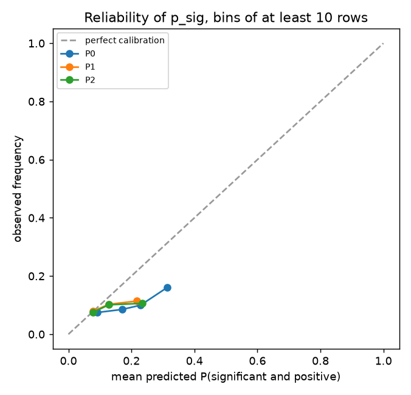
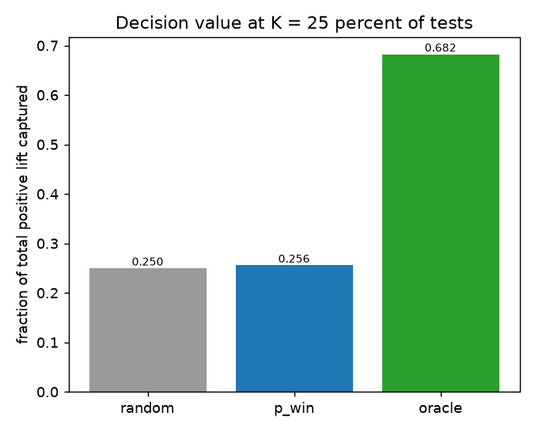
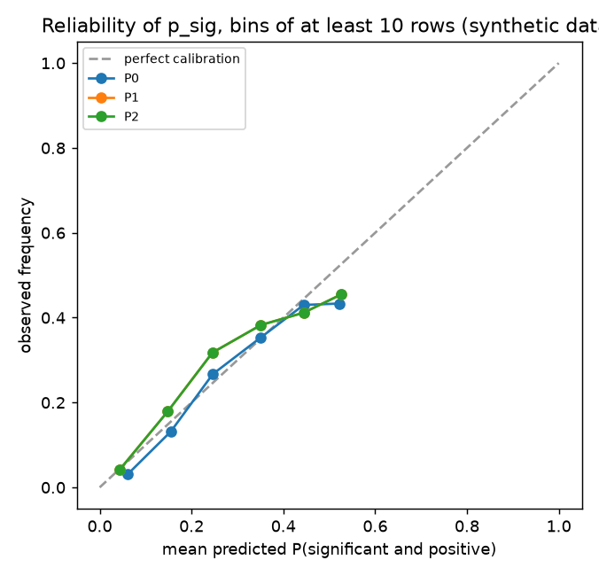
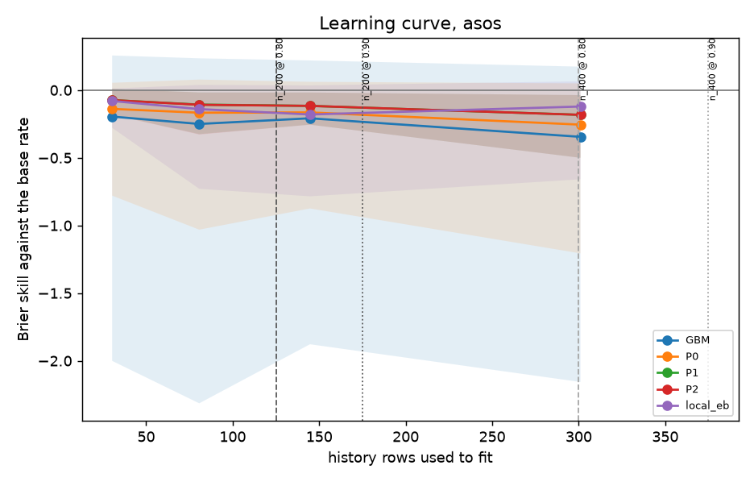
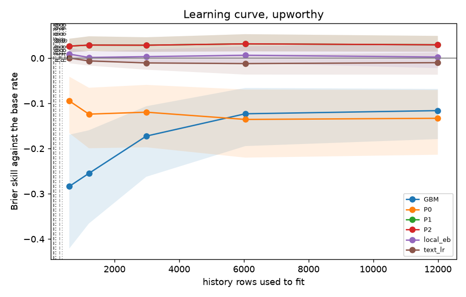

# Moot Court

Moot Court argues the next experiment from precedent before the trial: it keeps a ledger of concluded online tests, predicts what the ledger implies about a proposed test, scores every prediction against the live result, and declines to rule when the ledger has nothing to say.

The card prioritizes and sizes the test. The live test decides. Moot Court never touches a ship, allocation or stopping rule.

Skill on headline tests does not transfer to product deployments, and nothing here shows that it does.

## What the project does not show

- **Headline-test skill is not deployment skill.** The main archive is a set of headline and image tests from one publisher. Nothing here measures whether a ladder that predicts them predicts product experiments.
- **ASOS cells are mostly undecidable at their n.** The deployment-shaped archive has a few hundred contrasts. The results below mark each cell as decidable or undecidable at the release gate, and most are undecidable.
- **The ASOS backtest says nothing about drift.** That file has no dates, so its calendar is nominal (see `DATA.md`).
- **The scores are against the observed estimate, not the unknown true effect.** A predictor is judged on the estimate a test produced, noise included.
- **The 7-day horizon is a modeling choice.** The Upworthy archive does not record when a test was read. A test is treated as final seven days after its latest arm was created, for every contrast of that test.
- **Realized impressions stand in for planned exposure.** The Upworthy archive does not record the planned exposure of an arm, so the forecaster's scale uses the arm's realized impressions. That stand-in can leak: log impressions correlate +0.099 with the absolute standardized effect on the admitted rows (`DATA.md`, `docs/method.md` call 53).
- **Not every part of the ladder is exercised on real data.** The team-forecast rung needs a frozen forecast made before the test, and no archive holds one. It runs on synthetic data only. The results below say which abstention triggers fired on real data.
- **It is not a decision tool.** No ship, rollout, allocation, ramp or stopping recommendation comes out of it, and the card never contains one.

## Results

These tables are produced by the commands under "Run it" and rendered from the report files by `scripts/render_readme_results.py`. Nulls are reported as nulls.

The first full run scored Upworthy on a relative lift against a noisy reference arm, with the realized standard error as the forecaster's scale, and every rung had negative skill. That was a design defect, not a finding about the archive. The effect is now the absolute click-through difference in percentage points, and the forecaster's scale and features use only what is known before launch. `docs/method.md` (calls 52 to 55) tells the story with the numbers.

<!-- moot-results:start -->
_Generated by `scripts/render_readme_results.py` from the report JSON files. Do not edit by hand. Intervals are 90 percent bootstrap intervals that resample whole tests._

### Upworthy backtest

Snapshot 20261103-4bfb354b87e3, model 5f1c07efd730, seed 0. 13247 rows scored over 9 quarterly origins out of 13453 admitted. Command: `moot backtest --source upworthy --origins quarterly --seed 0`.

| cell | rung | n | log score | Brier skill (90% interval) | decidable by tests (0.90 gate) | decidable by rows (0.90 gate, overstates) | decidable by tests (0.80 screen) | coverage 80% / 90% | abstention rate |
|---|---|---|---|---|---|---|---|---|---|
| ALL | P0 | 13247 | -1.0259 | -0.1237 (-0.1401 to -0.1073) | yes, both skills | yes, both skills | yes, both skills | 0.9165 / 0.9546 | 0.0878 |
| ALL | P1 | 13247 | -0.8812 | 0.0015 (-0.0018 to 0.0048) | yes, both skills | yes, both skills | yes, both skills | 0.8122 / 0.8945 | 0.0878 |
| ALL | P2 | 13247 | -0.8957 | -0.0078 (-0.0119 to -0.0032) | yes, both skills | yes, both skills | yes, both skills | 0.8225 / 0.8999 | 0.0878 |
| ALL | always_reference | 13247 | n/a | n/a (n/a to n/a) | yes, both skills | yes, both skills | yes, both skills | n/a / n/a | 0.0878 |
| ALL | always_variant | 13247 | n/a | n/a (n/a to n/a) | yes, both skills | yes, both skills | yes, both skills | n/a / n/a | 0.0878 |
| both | P0 | 471 | -1.3349 | -0.1369 (-0.2603 to -0.0536) | skill 0.20 only | yes, both skills | skill 0.20 only | 0.9002 / 0.9469 | 0.2102 |
| both | P1 | 471 | -1.2696 | 0.0209 (-0.0003 to 0.0419) | skill 0.20 only | yes, both skills | skill 0.20 only | 0.7728 / 0.8684 | 0.2102 |
| both | P2 | 471 | -1.2696 | 0.0209 (-0.0003 to 0.0419) | skill 0.20 only | yes, both skills | skill 0.20 only | 0.7728 / 0.8684 | 0.2102 |
| both | always_reference | 471 | n/a | n/a (n/a to n/a) | skill 0.20 only | yes, both skills | skill 0.20 only | n/a / n/a | 0.2102 |
| both | always_variant | 471 | n/a | n/a (n/a to n/a) | skill 0.20 only | yes, both skills | skill 0.20 only | n/a / n/a | 0.2102 |
| headline_only | P0 | 7417 | -1.0532 | -0.1235 (-0.1443 to -0.1036) | yes, both skills | yes, both skills | yes, both skills | 0.9218 / 0.9577 | 0.1026 |
| headline_only | P1 | 7417 | -0.8907 | -0.0043 (-0.0085 to -0.0006) | yes, both skills | yes, both skills | yes, both skills | 0.8179 / 0.9025 | 0.1026 |
| headline_only | P2 | 7417 | -0.9166 | -0.0195 (-0.0259 to -0.0137) | yes, both skills | yes, both skills | yes, both skills | 0.8362 / 0.9121 | 0.1026 |
| headline_only | always_reference | 7417 | n/a | n/a (n/a to n/a) | yes, both skills | yes, both skills | yes, both skills | n/a / n/a | 0.1026 |
| headline_only | always_variant | 7417 | n/a | n/a (n/a to n/a) | yes, both skills | yes, both skills | yes, both skills | n/a / n/a | 0.1026 |
| image_only | P0 | 5359 | -0.9611 | -0.1223 (-0.1536 to -0.0946) | yes, both skills | yes, both skills | yes, both skills | 0.9106 / 0.9509 | 0.0565 |
| image_only | P1 | 5359 | -0.8340 | 0.0092 (0.0025 to 0.0154) | yes, both skills | yes, both skills | yes, both skills | 0.8078 / 0.8858 | 0.0565 |
| image_only | P2 | 5359 | -0.8340 | 0.0092 (0.0025 to 0.0154) | yes, both skills | yes, both skills | yes, both skills | 0.8078 / 0.8858 | 0.0565 |
| image_only | always_reference | 5359 | n/a | n/a (n/a to n/a) | yes, both skills | yes, both skills | yes, both skills | n/a / n/a | 0.0565 |
| image_only | always_variant | 5359 | n/a | n/a (n/a to n/a) | yes, both skills | yes, both skills | yes, both skills | n/a / n/a | 0.0565 |

P2 Brier skill against the base rate on all rows: -0.0078 (-0.0119 to -0.0032), which is worse than the constant base rate. Its calibration error is 0.0219, at percentile 100.0 of the perfect-calibration null.

Reliability bins: P2 rows predicted between 0.10 and 0.20 (7433 rows, mean predicted 0.1284) were followed by a significant positive result 0.1013 of the time.

Log score on all rows: P0 -1.0259, P1 -0.8812, P2 -0.8957. P2 minus P1 is -0.0145, so the precedent rung scores worse than the prior.

Calibration by precision: rows in deciles of planned exposures per arm (fewer groups when exposures tie). A forecaster calibrated overall but not within these groups is not calibrated; `mean p_sig` should match `event rate` and `coverage 90%` should be near 0.90 in every group.

| rung | decile | planned exposures per arm | n | mean s_star | mean p_sig | event rate | coverage 90% |
|---|---|---|---|---|---|---|---|
| P1 | 1 | 1128 to 2264 | 1324 | 0.4027 | 0.0764 | 0.0650 | 0.8746 |
| P1 | 2 | 2264 to 2672 | 1325 | 0.3626 | 0.0952 | 0.0906 | 0.8634 |
| P1 | 3 | 2672 to 2851 | 1324 | 0.3329 | 0.0985 | 0.0906 | 0.8293 |
| P1 | 4 | 2852 to 3048 | 1320 | 0.3235 | 0.0883 | 0.1038 | 0.8848 |
| P1 | 5 | 3049 to 3206 | 1329 | 0.3202 | 0.0851 | 0.0813 | 0.9037 |
| P1 | 6 | 3207 to 3560 | 1325 | 0.3158 | 0.1036 | 0.0853 | 0.8898 |
| P1 | 7 | 3560 to 3936 | 1326 | 0.2991 | 0.1064 | 0.1048 | 0.9163 |
| P1 | 8 | 3936 to 4576 | 1323 | 0.2844 | 0.1130 | 0.0975 | 0.9085 |
| P1 | 9 | 4577 to 5503 | 1326 | 0.2652 | 0.1261 | 0.0814 | 0.9314 |
| P1 | 10 | 5504 to 16906 | 1325 | 0.2292 | 0.1519 | 0.1102 | 0.9434 |
| P2 | 1 | 1128 to 2264 | 1324 | 0.4027 | 0.0782 | 0.0650 | 0.8754 |
| P2 | 2 | 2264 to 2672 | 1325 | 0.3626 | 0.0970 | 0.0906 | 0.8642 |
| P2 | 3 | 2672 to 2851 | 1324 | 0.3329 | 0.1015 | 0.0906 | 0.8308 |
| P2 | 4 | 2852 to 3048 | 1320 | 0.3235 | 0.0988 | 0.1038 | 0.8970 |
| P2 | 5 | 3049 to 3206 | 1329 | 0.3202 | 0.0994 | 0.0813 | 0.9180 |
| P2 | 6 | 3207 to 3560 | 1325 | 0.3158 | 0.1110 | 0.0853 | 0.8951 |
| P2 | 7 | 3560 to 3936 | 1326 | 0.2991 | 0.1167 | 0.1048 | 0.9208 |
| P2 | 8 | 3936 to 4576 | 1323 | 0.2844 | 0.1241 | 0.0975 | 0.9138 |
| P2 | 9 | 4577 to 5503 | 1326 | 0.2652 | 0.1360 | 0.0814 | 0.9367 |
| P2 | 10 | 5504 to 16906 | 1325 | 0.2292 | 0.1668 | 0.1102 | 0.9472 |

Direction accuracy against its ceiling, every rung and the two direction baselines (always the reference arm, always the variant):

| rung | kind | direction accuracy (90% interval) | ceiling |
|---|---|---|---|
| P0 | ladder | 0.5759 (0.5659 to 0.5853) | 0.8229 |
| P1 | ladder | 0.5725 (0.5627 to 0.5816) | 0.8229 |
| P2 | ladder | 0.5725 (0.5626 to 0.5815) | 0.8229 |
| always_reference | baseline | 0.5785 (0.5679 to 0.5880) | 0.8229 |
| always_variant | baseline | 0.4215 (0.4120 to 0.4321) | 0.8229 |

Abstention by trigger (rows that fired each trigger; a row can fire several):

| cell | rows | abstention rate | support | novelty | reliability | instability |
|---|---|---|---|---|---|---|
| ALL | 13247 | 0.0878 | 304 | 382 | 781 | 0 |
| both | 471 | 0.2102 | 68 | 31 | 68 | 0 |
| headline_only | 7417 | 0.1026 | 0 | 284 | 477 | 0 |
| image_only | 5359 | 0.0565 | 236 | 67 | 236 | 0 |

Never fired in this backtest: instability. After the burn-in origin the reliability trigger fired on 0 rows, so no cell was marked drifted and every reliability abstention is the missing report at the burn-in origin.

Decision value, pooled over origins: choosing a quarter of the tests at random captures 0.2498 of the total positive observed lift, choosing by P2 p_win captures 0.2558, and an oracle that knows the result captures 0.6824. No interval is computed for the difference between random and p_win, so it is not evidence of an edge.

### ASOS backtest

Snapshot 20261103-6bb5a15c5ff0, model 548c646b9cb1, seed 0. 337 rows scored over 7 quarterly origins out of 381 admitted. Command: `moot backtest --source asos --origins quarterly --seed 0`.

| cell | rung | n | log score | Brier skill (90% interval) | decidable by tests (0.90 gate) | decidable by rows (0.90 gate, overstates) | decidable by tests (0.80 screen) | coverage 80% / 90% | abstention rate |
|---|---|---|---|---|---|---|---|---|---|
| ALL | P0 | 337 | 4.3831 | -0.4432 (-0.8362 to -0.1848) | undecidable | skill 0.20 only | undecidable | 0.9050 / 0.9258 | 0.4481 |
| ALL | P1 | 337 | 4.6095 | -0.1073 (-0.2366 to -0.0020) | undecidable | skill 0.20 only | undecidable | 0.7834 / 0.8605 | 0.4481 |
| ALL | P2 | 337 | 4.6095 | -0.1073 (-0.2366 to -0.0020) | undecidable | skill 0.20 only | undecidable | 0.7834 / 0.8605 | 0.4481 |
| ALL | always_reference | 337 | n/a | n/a (n/a to n/a) | undecidable | skill 0.20 only | undecidable | n/a / n/a | 0.4481 |
| ALL | always_variant | 337 | n/a | n/a (n/a to n/a) | undecidable | skill 0.20 only | undecidable | n/a / n/a | 0.4481 |
| metric_1 | P0 | 85 | 4.1326 | -0.5534 (-1.1732 to -0.2004) | undecidable | undecidable | undecidable | 0.9059 / 0.9294 | 0.3294 |
| metric_1 | P1 | 85 | 4.2880 | -0.1882 (-0.3771 to -0.0502) | undecidable | undecidable | undecidable | 0.7647 / 0.8471 | 0.3294 |
| metric_1 | P2 | 85 | 4.2880 | -0.1882 (-0.3771 to -0.0502) | undecidable | undecidable | undecidable | 0.7647 / 0.8471 | 0.3294 |
| metric_1 | always_reference | 85 | n/a | n/a (n/a to n/a) | undecidable | undecidable | undecidable | n/a / n/a | 0.3294 |
| metric_1 | always_variant | 85 | n/a | n/a (n/a to n/a) | undecidable | undecidable | undecidable | n/a / n/a | 0.3294 |
| metric_2 | P0 | 84 | 4.2543 | -0.6874 (-1.5024 to -0.2942) | undecidable | undecidable | undecidable | 0.9048 / 0.9286 | 0.4881 |
| metric_2 | P1 | 84 | 4.5460 | -0.1629 (-0.3450 to -0.0545) | undecidable | undecidable | undecidable | 0.7738 / 0.8690 | 0.4881 |
| metric_2 | P2 | 84 | 4.5460 | -0.1629 (-0.3450 to -0.0545) | undecidable | undecidable | undecidable | 0.7738 / 0.8690 | 0.4881 |
| metric_2 | always_reference | 84 | n/a | n/a (n/a to n/a) | undecidable | undecidable | undecidable | n/a / n/a | 0.4881 |
| metric_2 | always_variant | 84 | n/a | n/a (n/a to n/a) | undecidable | undecidable | undecidable | n/a / n/a | 0.4881 |
| metric_3 | P0 | 84 | 4.5462 | -0.3933 (-1.0700 to -0.0963) | undecidable | undecidable | undecidable | 0.8929 / 0.9167 | 0.4881 |
| metric_3 | P1 | 84 | 4.7810 | -0.1200 (-0.3727 to 0.0184) | undecidable | undecidable | undecidable | 0.7738 / 0.8571 | 0.4881 |
| metric_3 | P2 | 84 | 4.7810 | -0.1200 (-0.3727 to 0.0184) | undecidable | undecidable | undecidable | 0.7738 / 0.8571 | 0.4881 |
| metric_3 | always_reference | 84 | n/a | n/a (n/a to n/a) | undecidable | undecidable | undecidable | n/a / n/a | 0.4881 |
| metric_3 | always_variant | 84 | n/a | n/a (n/a to n/a) | undecidable | undecidable | undecidable | n/a / n/a | 0.4881 |
| metric_4 | P0 | 84 | 4.6024 | -0.1957 (-0.4195 to -0.0434) | undecidable | undecidable | undecidable | 0.9167 / 0.9286 | 0.4881 |
| metric_4 | P1 | 84 | 4.8270 | 0.0201 (-0.0611 to 0.1268) | undecidable | undecidable | undecidable | 0.8214 / 0.8690 | 0.4881 |
| metric_4 | P2 | 84 | 4.8270 | 0.0201 (-0.0611 to 0.1268) | undecidable | undecidable | undecidable | 0.8214 / 0.8690 | 0.4881 |
| metric_4 | always_reference | 84 | n/a | n/a (n/a to n/a) | undecidable | undecidable | undecidable | n/a / n/a | 0.4881 |
| metric_4 | always_variant | 84 | n/a | n/a (n/a to n/a) | undecidable | undecidable | undecidable | n/a / n/a | 0.4881 |

P2 Brier skill against the base rate on all rows: -0.1073 (-0.2366 to -0.0020), which is worse than the constant base rate. Its calibration error is 0.1271, at percentile 100.0 of the perfect-calibration null.

Reliability bins: P2 rows predicted between 0.10 and 0.20 (86 rows, mean predicted 0.1426) were followed by a significant positive result 0.1860 of the time.

Log score on all rows: P0 4.3831, P1 4.6095, P2 4.6095. P2 minus P1 is +0.0000, so the precedent rung adds nothing measurable over the prior.

Calibration by precision: rows in deciles of planned exposures per arm (fewer groups when exposures tie). A forecaster calibrated overall but not within these groups is not calibrated; `mean p_sig` should match `event rate` and `coverage 90%` should be near 0.90 in every group.

| rung | decile | planned exposures per arm | n | mean s_star | mean p_sig | event rate | coverage 90% |
|---|---|---|---|---|---|---|---|
| P1 | 1 | 34562 to 340564 | 32 | 0.0034 | 0.0366 | 0.0000 | 0.9375 |
| P1 | 2 | 340820 to 1180866 | 36 | 0.0017 | 0.1101 | 0.1667 | 0.6944 |
| P1 | 3 | 1332250 to 1740448 | 32 | 0.0014 | 0.0819 | 0.1562 | 0.8438 |
| P1 | 4 | 1774930 to 2747588 | 33 | 0.0010 | 0.1417 | 0.0000 | 1.0000 |
| P1 | 5 | 2837012 to 3166310 | 32 | 0.0008 | 0.1799 | 0.2500 | 0.6562 |
| P1 | 6 | 3169067 to 3834889 | 36 | 0.0008 | 0.1104 | 0.2500 | 0.8611 |
| P1 | 7 | 4298617 to 5378401 | 32 | 0.0006 | 0.2089 | 0.2500 | 0.9688 |
| P1 | 8 | 5791554 to 17035892 | 36 | 0.0005 | 0.2639 | 0.1389 | 0.7778 |
| P1 | 9 | 18803522 to 28466639 | 32 | 0.0003 | 0.3293 | 0.0312 | 0.8750 |
| P1 | 10 | 31473741 to 64815188 | 36 | 0.0002 | 0.3124 | 0.1389 | 1.0000 |
| P2 | 1 | 34562 to 340564 | 32 | 0.0034 | 0.0366 | 0.0000 | 0.9375 |
| P2 | 2 | 340820 to 1180866 | 36 | 0.0017 | 0.1101 | 0.1667 | 0.6944 |
| P2 | 3 | 1332250 to 1740448 | 32 | 0.0014 | 0.0819 | 0.1562 | 0.8438 |
| P2 | 4 | 1774930 to 2747588 | 33 | 0.0010 | 0.1417 | 0.0000 | 1.0000 |
| P2 | 5 | 2837012 to 3166310 | 32 | 0.0008 | 0.1799 | 0.2500 | 0.6562 |
| P2 | 6 | 3169067 to 3834889 | 36 | 0.0008 | 0.1104 | 0.2500 | 0.8611 |
| P2 | 7 | 4298617 to 5378401 | 32 | 0.0006 | 0.2089 | 0.2500 | 0.9688 |
| P2 | 8 | 5791554 to 17035892 | 36 | 0.0005 | 0.2639 | 0.1389 | 0.7778 |
| P2 | 9 | 18803522 to 28466639 | 32 | 0.0003 | 0.3293 | 0.0312 | 0.8750 |
| P2 | 10 | 31473741 to 64815188 | 36 | 0.0002 | 0.3124 | 0.1389 | 1.0000 |

Direction accuracy against its ceiling, every rung and the two direction baselines (always the reference arm, always the variant):

| rung | kind | direction accuracy (90% interval) | ceiling |
|---|---|---|---|
| P0 | ladder | 0.4985 (0.4344 to 0.5696) | 0.8064 |
| P1 | ladder | 0.5223 (0.4426 to 0.5878) | 0.8064 |
| P2 | ladder | 0.5223 (0.4426 to 0.5878) | 0.8064 |
| always_reference | baseline | 0.4955 (0.4214 to 0.5636) | 0.8064 |
| always_variant | baseline | 0.5045 (0.4364 to 0.5786) | 0.8064 |

The ASOS calendar is nominal (see DATA.md): the file has no dates, so this backtest predicts across an arbitrary order and says nothing about drift. Per-metric cells are small, and the table says which are undecidable at their n.

### Synthetic backtest (synthetic data, known truth)

Snapshot 20261103-bf4fd286e2b2, model c0a83586ddb2, seed 0. 1814 rows scored over 8 quarterly origins out of 2000 admitted. Command: `moot backtest --source synthetic --origins quarterly --seed 0`.

| cell | rung | n | log score | Brier skill (90% interval) | decidable by tests (0.90 gate) | decidable by rows (0.90 gate, overstates) | decidable by tests (0.80 screen) | coverage 80% / 90% | abstention rate |
|---|---|---|---|---|---|---|---|---|---|
| ALL | P0 | 1814 | -2.4073 | 0.0092 (-0.0082 to 0.0255) | yes, both skills | yes, both skills | yes, both skills | 0.8567 / 0.9432 | 0.1803 |
| ALL | P1 | 1814 | -2.3946 | 0.0023 (-0.0128 to 0.0168) | yes, both skills | yes, both skills | yes, both skills | 0.7834 / 0.8908 | 0.1803 |
| ALL | P2 | 1814 | -2.3946 | 0.0023 (-0.0128 to 0.0168) | yes, both skills | yes, both skills | yes, both skills | 0.7834 / 0.8908 | 0.1803 |
| ALL | always_reference | 1814 | n/a | n/a (n/a to n/a) | yes, both skills | yes, both skills | yes, both skills | n/a / n/a | 0.1803 |
| ALL | always_variant | 1814 | n/a | n/a (n/a to n/a) | yes, both skills | yes, both skills | yes, both skills | n/a / n/a | 0.1803 |
| both | P0 | 650 | -2.3456 | 0.0346 (0.0027 to 0.0577) | skill 0.20 only | yes, both skills | yes, both skills | 0.8538 / 0.9308 | 0.1738 |
| both | P1 | 650 | -2.3435 | 0.0305 (0.0121 to 0.0458) | skill 0.20 only | yes, both skills | yes, both skills | 0.7738 / 0.8738 | 0.1738 |
| both | P2 | 650 | -2.3435 | 0.0305 (0.0121 to 0.0458) | skill 0.20 only | yes, both skills | yes, both skills | 0.7738 / 0.8738 | 0.1738 |
| both | always_reference | 650 | n/a | n/a (n/a to n/a) | skill 0.20 only | yes, both skills | yes, both skills | n/a / n/a | 0.1738 |
| both | always_variant | 650 | n/a | n/a (n/a to n/a) | skill 0.20 only | yes, both skills | yes, both skills | n/a / n/a | 0.1738 |
| headline_only | P0 | 592 | -2.6688 | -0.0027 (-0.0220 to 0.0164) | skill 0.20 only | yes, both skills | skill 0.20 only | 0.8345 / 0.9324 | 0.1841 |
| headline_only | P1 | 592 | -2.6670 | -0.0159 (-0.0360 to 0.0064) | skill 0.20 only | yes, both skills | skill 0.20 only | 0.7821 / 0.8919 | 0.1841 |
| headline_only | P2 | 592 | -2.6670 | -0.0159 (-0.0360 to 0.0064) | skill 0.20 only | yes, both skills | skill 0.20 only | 0.7821 / 0.8919 | 0.1841 |
| headline_only | always_reference | 592 | n/a | n/a (n/a to n/a) | skill 0.20 only | yes, both skills | skill 0.20 only | n/a / n/a | 0.1841 |
| headline_only | always_variant | 592 | n/a | n/a (n/a to n/a) | skill 0.20 only | yes, both skills | skill 0.20 only | n/a / n/a | 0.1841 |
| image_only | P0 | 572 | -2.2067 | -0.0258 (-0.1007 to 0.0137) | skill 0.20 only | yes, both skills | skill 0.20 only | 0.8829 / 0.9685 | 0.1836 |
| image_only | P1 | 572 | -2.1709 | 0.0046 (-0.0154 to 0.0176) | skill 0.20 only | yes, both skills | skill 0.20 only | 0.7955 / 0.9091 | 0.1836 |
| image_only | P2 | 572 | -2.1709 | 0.0046 (-0.0154 to 0.0176) | skill 0.20 only | yes, both skills | skill 0.20 only | 0.7955 / 0.9091 | 0.1836 |
| image_only | always_reference | 572 | n/a | n/a (n/a to n/a) | skill 0.20 only | yes, both skills | skill 0.20 only | n/a / n/a | 0.1836 |
| image_only | always_variant | 572 | n/a | n/a (n/a to n/a) | skill 0.20 only | yes, both skills | skill 0.20 only | n/a / n/a | 0.1836 |

P2 Brier skill against the base rate on all rows: 0.0023 (-0.0128 to 0.0168), which is not distinguishable from the constant base rate. Its calibration error is 0.0265, at percentile 97.8 of the perfect-calibration null.

Reliability bins: P2 rows predicted between 0.10 and 0.20 (442 rows, mean predicted 0.1480) were followed by a significant positive result 0.1787 of the time.

Log score on all rows: P0 -2.4073, P1 -2.3946, P2 -2.3946. P2 minus P1 is +0.0000, so the precedent rung adds nothing measurable over the prior.

Calibration by precision: rows in deciles of planned exposures per arm (fewer groups when exposures tie). A forecaster calibrated overall but not within these groups is not calibrated; `mean p_sig` should match `event rate` and `coverage 90%` should be near 0.90 in every group.

| rung | decile | planned exposures per arm | n | mean s_star | mean p_sig | event rate | coverage 90% |
|---|---|---|---|---|---|---|---|
| P1 | 1 | 2002 to 5556 | 182 | 1.5560 | 0.1813 | 0.2198 | 0.9011 |
| P1 | 2 | 5584 to 9628 | 181 | 1.5650 | 0.1751 | 0.1989 | 0.8950 |
| P1 | 3 | 9630 to 13538 | 181 | 1.5370 | 0.1812 | 0.2099 | 0.9116 |
| P1 | 4 | 13550 to 17712 | 182 | 1.5299 | 0.1726 | 0.1978 | 0.8736 |
| P1 | 5 | 17714 to 20857 | 181 | 1.5527 | 0.2003 | 0.1492 | 0.9116 |
| P1 | 6 | 20870 to 24762 | 181 | 1.5484 | 0.1728 | 0.2044 | 0.9006 |
| P1 | 7 | 24776 to 28269 | 182 | 1.5377 | 0.1936 | 0.2143 | 0.9176 |
| P1 | 8 | 28286 to 32089 | 181 | 1.5378 | 0.1766 | 0.2155 | 0.8895 |
| P1 | 9 | 32128 to 36086 | 181 | 1.5553 | 0.1885 | 0.1602 | 0.8729 |
| P1 | 10 | 36119 to 39977 | 182 | 1.5889 | 0.1766 | 0.2198 | 0.8352 |
| P2 | 1 | 2002 to 5556 | 182 | 1.5560 | 0.1813 | 0.2198 | 0.9011 |
| P2 | 2 | 5584 to 9628 | 181 | 1.5650 | 0.1751 | 0.1989 | 0.8950 |
| P2 | 3 | 9630 to 13538 | 181 | 1.5370 | 0.1812 | 0.2099 | 0.9116 |
| P2 | 4 | 13550 to 17712 | 182 | 1.5299 | 0.1726 | 0.1978 | 0.8736 |
| P2 | 5 | 17714 to 20857 | 181 | 1.5527 | 0.2003 | 0.1492 | 0.9116 |
| P2 | 6 | 20870 to 24762 | 181 | 1.5484 | 0.1728 | 0.2044 | 0.9006 |
| P2 | 7 | 24776 to 28269 | 182 | 1.5377 | 0.1936 | 0.2143 | 0.9176 |
| P2 | 8 | 28286 to 32089 | 181 | 1.5378 | 0.1766 | 0.2155 | 0.8895 |
| P2 | 9 | 32128 to 36086 | 181 | 1.5553 | 0.1885 | 0.1602 | 0.8729 |
| P2 | 10 | 36119 to 39977 | 182 | 1.5889 | 0.1766 | 0.2198 | 0.8352 |

Direction accuracy against its ceiling, every rung and the two direction baselines (always the reference arm, always the variant):

| rung | kind | direction accuracy (90% interval) | ceiling |
|---|---|---|---|
| P0 | ladder | 0.6483 (0.6284 to 0.6665) | 0.8091 |
| P1 | ladder | 0.6483 (0.6284 to 0.6665) | 0.8091 |
| P2 | ladder | 0.6483 (0.6284 to 0.6665) | 0.8091 |
| always_reference | baseline | 0.4598 (0.4404 to 0.4786) | 0.8091 |
| always_variant | baseline | 0.5402 (0.5214 to 0.5596) | 0.8091 |

### Synthetic gate power (synthetic data only)

Share of simulated gates whose 95 percent bootstrap interval for the Brier gain clears zero, base rate 0.3, 1000 replicates, seed 20261102. Sizes below read the same power curve at two levels.

| power target | rows for skill 0.20 | rows for skill 0.10 |
|---|---|---|
| 0.80 (research screen) | 125 | 300 |
| 0.90 (release gate) | 175 | 375 |

| Brier skill \ scored rows | 100 | 125 | 175 | 250 | 300 | 375 | 500 | 1000 | 2000 |
|---|---|---|---|---|---|---|---|---|---|
| 0.05 | 0.23 | 0.24 | 0.34 | 0.49 | 0.53 | 0.61 | 0.72 | 0.95 | 1.00 |
| 0.10 | 0.40 | 0.47 | 0.59 | 0.74 | 0.84 | 0.90 | 0.96 | 1.00 | 1.00 |
| 0.20 | 0.71 | 0.81 | 0.93 | 0.98 | 0.99 | 1.00 | 1.00 | 1.00 | 1.00 |
| 0.30 | 0.90 | 0.94 | 0.99 | 1.00 | 1.00 | 1.00 | 1.00 | 1.00 | 1.00 |

### Figures

Reliability diagram of p_sig, Upworthy:



Decision value, Upworthy:



Reliability diagram of p_sig, synthetic data with known truth:



### Challengers (GBM, local_eb, text_lr), Upworthy

Same features, same origins, same rows as the ladder. Rows below are all cells pooled. `kind` marks challengers and direction baselines; a rung without a density has no log score, and a rung without a probability has no Brier skill.

| rung | kind | n | log score | Brier skill (90% interval) | direction accuracy | abstention rate |
|---|---|---|---|---|---|---|
| GBM | challenger | 13247 | -1.0153 | -0.1347 (-0.1540 to -0.1151) | 0.5425 | 0.0878 |
| P0 | ladder | 13247 | -1.0259 | -0.1237 (-0.1401 to -0.1073) | 0.5759 | 0.0878 |
| P1 | ladder | 13247 | -0.8812 | 0.0015 (-0.0018 to 0.0048) | 0.5725 | 0.0878 |
| P2 | ladder | 13247 | -0.8957 | -0.0078 (-0.0119 to -0.0032) | 0.5725 | 0.0878 |
| always_reference | baseline | 13247 | n/a | n/a (n/a to n/a) | 0.5785 | 0.0878 |
| always_variant | baseline | 13247 | n/a | n/a (n/a to n/a) | 0.4215 | 0.0878 |
| local_eb | challenger | 13247 | -0.9958 | -0.0152 (-0.0214 to -0.0091) | 0.5551 | 0.0878 |
| text_lr | challenger | 13247 | n/a | -0.0031 (-0.0079 to 0.0018) | 0.5565 | 0.0878 |

GBM minus P2 log score is -0.1196, so GBM is worse than P2 on this score.

local_eb minus P2 log score is -0.1001, so local_eb is worse than P2 on this score.

### Ablations, Upworthy

Each row is one backtest on the same origins and rows with one setting changed, written to its own report under `reports/ablations/`. All cells pooled. P2 minus P1 is the log score the precedents add; a value near zero means P2 reduced to the prior.

| setting | P1 log score | P2 log score | P2 minus P1 | P2 Brier skill (90% interval) | P2 direction accuracy | P2 coverage 90% |
|---|---|---|---|---|---|---|
| main run (defaults) | -0.8812 | -0.8957 | -0.0145 | -0.0078 (-0.0119 to -0.0032) | 0.5725 | 0.8999 |
| bandwidth-mult-0.125 | -0.8812 | -0.8892 | -0.0080 | -0.0012 (-0.0048 to 0.0026) | 0.5725 | 0.8989 |
| bandwidth-mult-0.25 | -0.8812 | -0.8956 | -0.0144 | -0.0098 (-0.0144 to -0.0046) | 0.5725 | 0.8994 |
| bandwidth-mult-0.5 | -0.8812 | -0.8961 | -0.0149 | -0.0083 (-0.0127 to -0.0032) | 0.5725 | 0.9001 |
| bandwidth-mult-1.0 | -0.8812 | -0.8963 | -0.0150 | -0.0088 (-0.0133 to -0.0037) | 0.5725 | 0.9001 |
| effect-scale-relative+s-star-realized | -4.9650 | -4.9650 | +0.0000 | -0.1074 (-0.1148 to -0.1011) | 0.5785 | 0.8839 |
| features-structured | -0.8812 | -0.8965 | -0.0152 | -0.0100 (-0.0146 to -0.0047) | 0.5725 | 0.9001 |
| features-text | -0.8812 | -0.8961 | -0.0149 | -0.0079 (-0.0124 to -0.0029) | 0.5725 | 0.9000 |
| kappa-0.0 | -0.8815 | -0.8959 | -0.0144 | -0.0091 (-0.0130 to -0.0041) | 0.5725 | 0.8997 |
| kappa-5.0 | -0.8802 | -0.8946 | -0.0145 | -0.0090 (-0.0130 to -0.0039) | 0.5725 | 0.9000 |
| kappa-80.0 | -0.8788 | -0.8934 | -0.0146 | -0.0076 (-0.0118 to -0.0025) | 0.5725 | 0.9011 |
| lambda-0.0 | -0.8812 | -0.8812 | +0.0000 | 0.0015 (-0.0018 to 0.0047) | 0.5725 | 0.8945 |
| lambda-0.2 | -0.8812 | -0.9662 | -0.0850 | -0.0558 (-0.0665 to -0.0457) | 0.5728 | 0.9265 |
| lambda-0.5 | -0.8812 | -0.9725 | -0.0913 | -0.0614 (-0.0731 to -0.0509) | 0.5756 | 0.9316 |
| lambda-1.0 | -0.8812 | -0.9922 | -0.1110 | -0.0787 (-0.0915 to -0.0672) | 0.5750 | 0.9399 |
| p2-guard-1.0 | -0.8812 | -0.9293 | -0.0481 | -0.0251 (-0.0318 to -0.0181) | 0.5722 | 0.9111 |
| p2-guard-off | -0.8812 | -0.9360 | -0.0547 | -0.0311 (-0.0386 to -0.0234) | 0.5718 | 0.9145 |
| p2-selection-forward+recency-select | -0.8812 | -0.8910 | -0.0097 | -0.0002 (-0.0043 to 0.0036) | 0.5759 | 0.8963 |
| p2-selection-forward | -0.8812 | -0.8909 | -0.0097 | -0.0001 (-0.0044 to 0.0037) | 0.5759 | 0.8963 |
| prior-normal | -0.9572 | -0.9660 | -0.0088 | -0.0249 (-0.0318 to -0.0185) | 0.5753 | 0.9160 |
| recency-select | -0.8812 | -0.8957 | -0.0145 | -0.0058 (-0.0096 to -0.0011) | 0.5725 | 0.8998 |

P2 selection by cell, over origins (lambda is the weight on precedents; `lambda zero` is the share of origins where it was 0):

| setting | cell | selection | origins | mean lambda | lambda zero | mean bandwidth multiplier | median half-life (days) |
|---|---|---|---|---|---|---|---|
| main run (defaults) | both | loto | 9 | 0.00 | 1.00 | 0.389 | none |
| main run (defaults) | headline_only | loto | 9 | 0.10 | 0.78 | 0.375 | none |
| main run (defaults) | image_only | loto | 9 | 0.00 | 1.00 | 0.917 | none |
| p2-selection-forward+recency-select | both | forward | 9 | 0.12 | 0.78 | 0.889 | 90 |
| p2-selection-forward+recency-select | headline_only | forward | 9 | 0.41 | 0.56 | 0.556 | 180 |
| p2-selection-forward+recency-select | image_only | forward | 9 | 0.20 | 0.78 | 0.764 | 90 |
| p2-selection-forward | both | forward | 9 | 0.12 | 0.78 | 0.889 | none |
| p2-selection-forward | headline_only | forward | 9 | 0.41 | 0.56 | 0.500 | none |
| p2-selection-forward | image_only | forward | 9 | 0.20 | 0.78 | 0.681 | none |
| recency-select | both | loto | 9 | 0.00 | 1.00 | 0.417 | 90 |
| recency-select | headline_only | loto | 9 | 0.10 | 0.78 | 0.375 | 135 |
| recency-select | image_only | loto | 9 | 0.00 | 1.00 | 0.833 | 90 |

### P2 admission guard, Upworthy

The admission guard is the ladder's admission rule made operational: a rung is used only when it beats the rung below out of sample by more than noise. For every cell and origin, P2 uses a precedent weight lambda above zero only when its out-of-sample log-score gain over lambda 0, minus 2.0 standard errors across tests, is above zero; otherwise lambda is 0 and P2 equals P1. Guarded is the main run; unguarded is `--p2-guard off`, the earlier rule that takes the best of the candidate lambdas whatever its noise. Both runs scored the same 13247 rows in 3797 tests. Intervals are 90 percent bootstrap intervals by test.

| selection | log score | CRPS | Brier skill | cells held at lambda 0 | held by the guard |
|---|---|---|---|---|---|
| guarded | -0.8957 (-0.9237 to -0.8691) | 0.3279 (0.3202 to 0.3360) | -0.0078 (-0.0119 to -0.0032) | 0.926 | 0.519 |
| unguarded | -0.9360 (-0.9631 to -0.9080) | 0.3323 (0.3253 to 0.3403) | -0.0311 (-0.0386 to -0.0234) | 0.407 | 0.000 |

Paired difference, guarded minus unguarded, on the same rows (positive log score and Brier skill favour the guard, negative CRPS favours the guard):

| log score | CRPS | Brier skill |
|---|---|---|
| +0.0403 (+0.0327 to +0.0481) | -0.0044 (-0.0049 to -0.0039) | +0.0233 (+0.0180 to +0.0281) |

### Ablations, Asos

Each row is one backtest on the same origins and rows with one setting changed, written to its own report under `reports/ablations/`. All cells pooled. P2 minus P1 is the log score the precedents add; a value near zero means P2 reduced to the prior.

| setting | P1 log score | P2 log score | P2 minus P1 | P2 Brier skill (90% interval) | P2 direction accuracy | P2 coverage 90% |
|---|---|---|---|---|---|---|
| main run (defaults) | 4.6095 | 4.6095 | +0.0000 | -0.1073 (-0.2366 to -0.0020) | 0.5223 | 0.8605 |
| kappa-0.0 | 4.5891 | 4.5891 | +0.0000 | -0.1190 (-0.2510 to -0.0140) | 0.5223 | 0.8427 |
| kappa-5.0 | 4.6016 | 4.6016 | +0.0000 | -0.1097 (-0.2404 to -0.0091) | 0.5223 | 0.8546 |
| kappa-80.0 | 4.6168 | 4.6168 | +0.0000 | -0.1077 (-0.2369 to -0.0170) | 0.5223 | 0.8724 |
| p2-guard-1.0 | 4.6095 | 4.5665 | -0.0430 | -0.1473 (-0.3546 to -0.0074) | 0.5282 | 0.8991 |
| p2-guard-off | 4.6095 | 4.4233 | -0.1863 | -0.2878 (-0.5773 to -0.0854) | 0.5163 | 0.9050 |
| prior-normal | 4.3318 | 4.3318 | +0.0000 | -0.3678 (-0.6886 to -0.1409) | 0.5104 | 0.8991 |

P2 selection by cell, over origins (lambda is the weight on precedents; `lambda zero` is the share of origins where it was 0):

| setting | cell | selection | origins | mean lambda | lambda zero | mean bandwidth multiplier | median half-life (days) |
|---|---|---|---|---|---|---|---|
| main run (defaults) | metric_1 | loto | 7 | 0.00 | 1.00 | 0.875 | none |
| main run (defaults) | metric_2 | loto | 7 | 0.00 | 1.00 | 1.000 | none |
| main run (defaults) | metric_3 | loto | 7 | 0.00 | 1.00 | 0.732 | none |
| main run (defaults) | metric_4 | loto | 7 | 0.00 | 1.00 | 0.732 | none |

### P2 admission guard, Asos

The admission guard is the ladder's admission rule made operational: a rung is used only when it beats the rung below out of sample by more than noise. For every cell and origin, P2 uses a precedent weight lambda above zero only when its out-of-sample log-score gain over lambda 0, minus 2.0 standard errors across tests, is above zero; otherwise lambda is 0 and P2 equals P1. Guarded is the main run; unguarded is `--p2-guard off`, the earlier rule that takes the best of the candidate lambdas whatever its noise. Both runs scored the same 337 rows in 68 tests. Intervals are 90 percent bootstrap intervals by test.

| selection | log score | CRPS | Brier skill | cells held at lambda 0 | held by the guard |
|---|---|---|---|---|---|
| guarded | 4.6095 (4.2135 to 4.9386) | 0.0014 (0.0010 to 0.0018) | -0.1073 (-0.2366 to -0.0020) | 1.000 | 0.821 |
| unguarded | 4.4233 (4.0871 to 4.7679) | 0.0014 (0.0011 to 0.0018) | -0.2878 (-0.5773 to -0.0854) | 0.179 | 0.000 |

Paired difference, guarded minus unguarded, on the same rows (positive log score and Brier skill favour the guard, negative CRPS favours the guard):

| log score | CRPS | Brier skill |
|---|---|---|
| +0.1863 (+0.0675 to +0.2992) | -0.0001 (-0.0001 to -0.0000) | +0.1806 (+0.0164 to +0.3284) |

### The cautionary run

The first full run scored Upworthy on the relative lift against the reference arm and gave the forecaster each row's realized standard error. It is reproduced here by `moot backtest --source upworthy --effect-scale relative --s-star realized`. A relative lift against a noisy reference arm is tied to its own standard error through the reference arm's realized rate, and the realized standard error is information from inside the test, so a calibrated forecaster could not have used it. The released protocol uses the absolute difference and a standard error known before launch.

13247 rows scored over 9 origins. Command: `moot backtest --source upworthy --origins quarterly --effect-scale relative --s-star realized --seed 0`.

| rung | n | log score | Brier skill (90% interval) | coverage 80% / 90% |
|---|---|---|---|---|
| P0 | 13247 | -5.1110 | -0.9888 (-1.0784 to -0.9138) | 0.9123 / 0.9710 |
| P1 | 13247 | -4.9650 | -0.1074 (-0.1148 to -0.1011) | 0.7780 / 0.8839 |
| P2 | 13247 | -4.9650 | -0.1074 (-0.1148 to -0.1011) | 0.7780 / 0.8839 |

Calibration by precision, deciles of the planned exposures per arm. `mean p_sig` should match `event rate` in every row; in the cautionary run it does not: p_sig is above the event rate in every decile, and the realized standard error stands in for information the forecaster could not have had.

| rung | decile | planned exposures per arm | n | mean s_star | mean p_sig | event rate | coverage 90% |
|---|---|---|---|---|---|---|---|
| P1 | 1 | 1128 to 2264 | 1324 | 27.0440 | 0.0586 | 0.0264 | 0.9094 |
| P1 | 2 | 2264 to 2672 | 1325 | 23.2034 | 0.0752 | 0.0438 | 0.8996 |
| P1 | 3 | 2672 to 2851 | 1324 | 22.2960 | 0.0804 | 0.0559 | 0.8905 |
| P1 | 4 | 2852 to 3048 | 1320 | 26.0043 | 0.0630 | 0.0470 | 0.8788 |
| P1 | 5 | 3049 to 3206 | 1329 | 24.7327 | 0.0581 | 0.0384 | 0.8871 |
| P1 | 6 | 3207 to 3560 | 1325 | 22.5001 | 0.0776 | 0.0430 | 0.8906 |
| P1 | 7 | 3560 to 3936 | 1326 | 23.9668 | 0.0695 | 0.0535 | 0.8793 |
| P1 | 8 | 3936 to 4576 | 1323 | 21.4215 | 0.0766 | 0.0642 | 0.8609 |
| P1 | 9 | 4577 to 5503 | 1326 | 20.9175 | 0.0800 | 0.0543 | 0.8831 |
| P1 | 10 | 5504 to 16906 | 1325 | 18.2120 | 0.0944 | 0.0853 | 0.8596 |
| P2 | 1 | 1128 to 2264 | 1324 | 27.0440 | 0.0586 | 0.0264 | 0.9094 |
| P2 | 2 | 2264 to 2672 | 1325 | 23.2034 | 0.0752 | 0.0438 | 0.8996 |
| P2 | 3 | 2672 to 2851 | 1324 | 22.2960 | 0.0804 | 0.0559 | 0.8905 |
| P2 | 4 | 2852 to 3048 | 1320 | 26.0043 | 0.0630 | 0.0470 | 0.8788 |
| P2 | 5 | 3049 to 3206 | 1329 | 24.7327 | 0.0581 | 0.0384 | 0.8871 |
| P2 | 6 | 3207 to 3560 | 1325 | 22.5001 | 0.0776 | 0.0430 | 0.8906 |
| P2 | 7 | 3560 to 3936 | 1326 | 23.9668 | 0.0695 | 0.0535 | 0.8793 |
| P2 | 8 | 3936 to 4576 | 1323 | 21.4215 | 0.0766 | 0.0642 | 0.8609 |
| P2 | 9 | 4577 to 5503 | 1326 | 20.9175 | 0.0800 | 0.0543 | 0.8831 |
| P2 | 10 | 5504 to 16906 | 1325 | 18.2120 | 0.0944 | 0.0853 | 0.8596 |

### Learning curve, Asos

Final origin 2020-10-01, 56 held-out rows in 9 tests, the same in every run. Each fraction keeps that share of the history's tests, 3 random subsamples per fraction. The interval is a 90 percent bootstrap by held-out test of the seed-averaged Brier skill.

- Gate sizes at power 0.80: n_200 = 125, n_400 = 300
- Gate sizes at power 0.90: n_200 = 175, n_400 = 375

| fraction | history rows | rung | Brier skill (90% interval) | seed sd | log score | direction accuracy |
|---|---|---|---|---|---|---|
| 0.1 | 30 | GBM | -0.1952 (-2.0007 to 0.2562) | 0.0040 | 3.5469 | 0.5119 |
| 0.1 | 30 | P0 | -0.1384 (-0.7793 to 0.0543) | 0.0754 | 2.0635 | 0.5000 |
| 0.1 | 30 | P1 | -0.0736 (-0.1805 to 0.0088) | 0.0289 | 0.2993 | 0.4524 |
| 0.1 | 30 | P2 | -0.0736 (-0.1805 to 0.0088) | 0.0289 | 0.2993 | 0.4524 |
| 0.1 | 30 | always_reference | n/a (n/a to n/a) | n/a | n/a | 0.3571 |
| 0.1 | 30 | always_variant | n/a (n/a to n/a) | n/a | n/a | 0.6429 |
| 0.1 | 30 | local_eb | -0.0800 (-0.2783 to 0.0115) | 0.0393 | 0.1068 | 0.4524 |
| 0.25 | 81 | GBM | -0.2498 (-2.3142 to 0.2353) | 0.0545 | 3.5459 | 0.4702 |
| 0.25 | 81 | P0 | -0.1668 (-1.0311 to 0.0782) | 0.0322 | 3.0094 | 0.5714 |
| 0.25 | 81 | P1 | -0.1067 (-0.3248 to -0.0162) | 0.0548 | 1.4112 | 0.4881 |
| 0.25 | 81 | P2 | -0.1083 (-0.3282 to -0.0178) | 0.0523 | 1.3429 | 0.5000 |
| 0.25 | 81 | always_reference | n/a (n/a to n/a) | n/a | n/a | 0.3571 |
| 0.25 | 81 | always_variant | n/a (n/a to n/a) | n/a | n/a | 0.6429 |
| 0.25 | 81 | local_eb | -0.1401 (-0.7288 to 0.0387) | 0.0793 | 1.6334 | 0.5476 |
| 0.5 | 145 | GBM | -0.2079 (-1.8779 to 0.2195) | 0.0708 | 3.5450 | 0.4881 |
| 0.5 | 145 | P0 | -0.1646 (-0.8743 to 0.0615) | 0.0868 | 3.3448 | 0.4286 |
| 0.5 | 145 | P1 | -0.1163 (-0.2552 to -0.0176) | 0.0750 | 2.8081 | 0.4524 |
| 0.5 | 145 | P2 | -0.1163 (-0.2552 to -0.0176) | 0.0750 | 2.8081 | 0.4524 |
| 0.5 | 145 | always_reference | n/a (n/a to n/a) | n/a | n/a | 0.3571 |
| 0.5 | 145 | always_variant | n/a (n/a to n/a) | n/a | n/a | 0.6429 |
| 0.5 | 145 | local_eb | -0.1800 (-0.7845 to 0.0350) | 0.1000 | 3.0780 | 0.4643 |
| 1.0 | 301 | GBM | -0.3451 (-2.1567 to 0.1738) | n/a | 3.5505 | 0.5357 |
| 1.0 | 301 | P0 | -0.2550 (-1.2063 to 0.0499) | n/a | 3.4901 | 0.6429 |
| 1.0 | 301 | P1 | -0.1824 (-0.5001 to -0.0368) | n/a | 3.5372 | 0.6429 |
| 1.0 | 301 | P2 | -0.1824 (-0.5001 to -0.0368) | n/a | 3.5372 | 0.6429 |
| 1.0 | 301 | always_reference | n/a (n/a to n/a) | n/a | n/a | 0.3571 |
| 1.0 | 301 | always_variant | n/a (n/a to n/a) | n/a | n/a | 0.6429 |
| 1.0 | 301 | local_eb | -0.1211 (-0.6585 to 0.0650) | n/a | 3.3299 | 0.5357 |



### Learning curve, Upworthy

Final origin 2015-01-01, 1143 held-out rows in 318 tests, the same in every run. Each fraction keeps that share of the history's tests, 3 random subsamples per fraction. The interval is a 90 percent bootstrap by held-out test of the seed-averaged Brier skill.

- Gate sizes at power 0.80: n_200 = 125, n_400 = 300
- Gate sizes at power 0.90: n_200 = 175, n_400 = 375

| fraction | history rows | rung | Brier skill (90% interval) | seed sd | log score | direction accuracy |
|---|---|---|---|---|---|---|
| 0.05 | 601 | GBM | -0.2836 (-0.4210 to -0.1692) | 0.2184 | -0.8907 | 0.5351 |
| 0.05 | 601 | P0 | -0.0946 (-0.1657 to -0.0410) | 0.0564 | -0.8613 | 0.5631 |
| 0.05 | 601 | P1 | 0.0266 (0.0131 to 0.0429) | 0.0059 | -0.7505 | 0.5731 |
| 0.05 | 601 | P2 | 0.0266 (0.0131 to 0.0429) | 0.0059 | -0.7505 | 0.5731 |
| 0.05 | 601 | always_reference | n/a (n/a to n/a) | n/a | n/a | 0.5731 |
| 0.05 | 601 | always_variant | n/a (n/a to n/a) | n/a | n/a | 0.4269 |
| 0.05 | 601 | local_eb | 0.0090 (-0.0029 to 0.0230) | 0.0152 | -0.8259 | 0.5383 |
| 0.05 | 601 | text_lr | 0.0004 (-0.0114 to 0.0103) | 0.0137 | n/a | 0.5634 |
| 0.1 | 1207 | GBM | -0.2548 (-0.3658 to -0.1595) | 0.0696 | -0.8941 | 0.5433 |
| 0.1 | 1207 | P0 | -0.1238 (-0.1992 to -0.0654) | 0.0358 | -0.8546 | 0.5731 |
| 0.1 | 1207 | P1 | 0.0289 (0.0154 to 0.0483) | 0.0066 | -0.7425 | 0.5681 |
| 0.1 | 1207 | P2 | 0.0289 (0.0154 to 0.0483) | 0.0066 | -0.7425 | 0.5681 |
| 0.1 | 1207 | always_reference | n/a (n/a to n/a) | n/a | n/a | 0.5731 |
| 0.1 | 1207 | always_variant | n/a (n/a to n/a) | n/a | n/a | 0.4269 |
| 0.1 | 1207 | local_eb | 0.0015 (-0.0088 to 0.0141) | 0.0196 | -0.7882 | 0.5445 |
| 0.1 | 1207 | text_lr | -0.0061 (-0.0165 to 0.0026) | 0.0048 | n/a | 0.5722 |
| 0.25 | 2982 | GBM | -0.1724 (-0.2624 to -0.1064) | 0.0182 | -0.8513 | 0.5383 |
| 0.25 | 2982 | P0 | -0.1195 (-0.1972 to -0.0591) | 0.0123 | -0.8421 | 0.5731 |
| 0.25 | 2982 | P1 | 0.0286 (0.0139 to 0.0462) | 0.0079 | -0.7322 | 0.5731 |
| 0.25 | 2982 | P2 | 0.0286 (0.0139 to 0.0462) | 0.0079 | -0.7322 | 0.5731 |
| 0.25 | 2982 | always_reference | n/a (n/a to n/a) | n/a | n/a | 0.5731 |
| 0.25 | 2982 | always_variant | n/a (n/a to n/a) | n/a | n/a | 0.4269 |
| 0.25 | 2982 | local_eb | 0.0034 (-0.0105 to 0.0191) | 0.0129 | -0.7976 | 0.5573 |
| 0.25 | 2982 | text_lr | -0.0106 (-0.0256 to 0.0016) | 0.0011 | n/a | 0.5556 |
| 0.5 | 6043 | GBM | -0.1231 (-0.1945 to -0.0659) | 0.0333 | -0.8453 | 0.5564 |
| 0.5 | 6043 | P0 | -0.1355 (-0.2200 to -0.0694) | 0.0131 | -0.8502 | 0.5731 |
| 0.5 | 6043 | P1 | 0.0316 (0.0150 to 0.0530) | 0.0047 | -0.7315 | 0.5731 |
| 0.5 | 6043 | P2 | 0.0316 (0.0150 to 0.0530) | 0.0047 | -0.7315 | 0.5731 |
| 0.5 | 6043 | always_reference | n/a (n/a to n/a) | n/a | n/a | 0.5731 |
| 0.5 | 6043 | always_variant | n/a (n/a to n/a) | n/a | n/a | 0.4269 |
| 0.5 | 6043 | local_eb | 0.0064 (-0.0109 to 0.0260) | 0.0072 | -0.7770 | 0.5474 |
| 0.5 | 6043 | text_lr | -0.0121 (-0.0364 to 0.0066) | 0.0111 | n/a | 0.5605 |
| 1.0 | 11997 | GBM | -0.1161 (-0.1790 to -0.0681) | n/a | -0.8533 | 0.5381 |
| 1.0 | 11997 | P0 | -0.1330 (-0.2136 to -0.0704) | n/a | -0.8496 | 0.5731 |
| 1.0 | 11997 | P1 | 0.0295 (0.0141 to 0.0492) | n/a | -0.7302 | 0.5731 |
| 1.0 | 11997 | P2 | 0.0295 (0.0141 to 0.0492) | n/a | -0.7302 | 0.5731 |
| 1.0 | 11997 | always_reference | n/a (n/a to n/a) | n/a | n/a | 0.5731 |
| 1.0 | 11997 | always_variant | n/a (n/a to n/a) | n/a | n/a | 0.4269 |
| 1.0 | 11997 | local_eb | 0.0025 (-0.0220 to 0.0320) | n/a | -0.7985 | 0.5547 |
| 1.0 | 11997 | text_lr | -0.0100 (-0.0366 to 0.0126) | n/a | n/a | 0.5626 |



### Card latency

Upworthy cards, 20000 impressions per arm, model 5f1c07efd730. Milliseconds.

| path | p50 | p95 | max |
|---|---|---|---|
| in process, bundle preloaded | 16.8 | 17.4 | 19.8 |
| HTTP service on loopback, bundle preloaded | 19.0 | 21.8 | 46.9 |
| command line, fresh process | 1124.1 | 1129.8 | 1130.4 |

### Run time

| stage | seconds |
|---|---|
| setup | 1.1 |
| data | 58.3 |
| power | 47.6 |
| fit-upworthy | 29.8 |
| backtest-upworthy | 192.5 |
| fit-asos | 1.8 |
| backtest-asos | 7.4 |
| fit-synthetic | 3.0 |
| backtest-synthetic | 21.4 |
| challenger-gbm | 374.6 |
| audit-upworthy | 3.2 |
| audit-asos | 0.6 |
| audit-synthetic | 0.6 |
| inventory | 3.8 |
| data-verify | 9.9 |
| latency | 9.1 |

Checksum verification 4.6 s (no download in this run), compute 760.1 s, total 764.7 s.
<!-- moot-results:end -->

## Why a ladder and not a gradient-boosted regressor

With tens to a few hundred rows in a cell, a boosted model on raw features cannot be checked for calibration cell by cell and gives no principled way to abstain. The ladder is interpretable at every rung, and each rung generalizes the one below it: the base rate (P0), an empirical-Bayes prior that weighs each row by its own standard error (P1), and weighted precedents shrunk toward that prior (P2). With the precedent weight at zero, P2 equals P1 exactly.

That claim is tested, not asserted. `moot backtest --challenger gbm` adds a gradient-boosted regressor on the same features, origins and rows as one more rung, and `make challengers` runs it in its own folder so it never replaces the main report. Its row in the results above is the result, whichever way it came out. Two more challengers sit beside it on the same rows: `local_eb` (an empirical-Bayes prior fit on the k nearest visible rows in feature space, with no shrinkage toward the cell prior) and `text_lr` (a TF-IDF logistic regression on the headline text that predicts the direction and the significant-positive event). Two direction baselines are scored beside every rung: always the reference arm and always the variant. The earliest-created arm is the reference, so the first one measures the creation-order effect the archive carries.

P2 sits behind an admission guard. Choosing the precedent weight from about forty candidates on the same validation rows fits noise, so a weight above zero is used for a cell and origin only when its out-of-sample log-score gain over weight zero, minus two standard errors across tests, is above zero (a rung is used only when it beats the rung below out of sample by more than noise). Otherwise P2 equals P1 for that cell and origin. The results above show guarded and unguarded selection side by side on the same rows; `--p2-guard off` runs the unguarded rule and `--p2-guard 1.0` loosens the guard to one standard error.

Ablations change one setting at a time (`--features`, `--bandwidth-mult`, `--lambda`, `--kappa`, `--prior`, `--p2-selection`, `--recency`, `--p2-guard`) and each writes its own report under `reports/ablations`. `moot backtest --learning-curve 0.1,0.25,0.5,1 --seeds 3` shows how skill grows with the history used, against the gate sizes. `make ablations` and `make learning-curve` run the full sets.

## Run it

You need Python 3.11 or newer and, ideally, `uv`. Without `uv` the Makefile falls back to a plain virtual environment.

```bash
make setup      # install
make data       # download the two archives into data/raw (about 15 MB), verify checksums, build the ledger
make fit        # fit P0, P1, P2 for one source (SOURCE=upworthy by default; also asos or synthetic)
make backtest   # rolling-origin backtest, writes reports/backtest-<source>-<snapshot>.md and .json plus figures
```

The first `make data` records a checksum of every file in `data/CHECKSUMS.json`; later runs verify them and stop on any mismatch.
A full run with the data already downloaded takes about ten minutes on a laptop; the measured times are in the results above.

### On your own results

`moot init` creates `mootcourt.toml`, the data folders, a synthetic sample ledger and quick gates, and prints the three commands that follow. `docs/quickstart.md` takes a fresh folder to a first card in ten minutes, with no network after the install. Your results come in as a file in the vendor-neutral ledger exchange format (aggregates only, CSV or Parquet) or as an export from an experimentation platform: `moot ingest --format FORMAT --input FILE --source-name NAME` (`moot ledger formats` lists them: generic, optimizely, harness, growthbook, jetstream, eppo, and the results view of one warehouse-native platform), with `--dry-run` to see the admission summary first and `moot ledger check FILE` to test a file against the format. Where a platform documents its export the mapping follows the documentation; where it does not, a mapping template to edit ships in `examples/mappings/`. `docs/ledger-format.md` has the columns, the variance estimator for ratio metrics and which assumptions to confirm. `moot doctor` checks the setup (versions, data root and free space, ledger, model freshness, reliability age, the service) and exits 0, 1 or 2.

A ledger can carry several metrics per experiment: each metric is its own cell, scored in its own block of the report, and a card names a primary metric and any number of guardrails with `--guardrail CELL:DELTA`. A guardrail shows `p_harm`, the probability that the true effect is worse than minus the margin, from the same ladder, and abstains on its own when its evidence is thin.

### Where the data lives

Everything heavy (the downloads, the ledger and its snapshots, models, reports, cards, caches and experiment outputs) sits under one root. Set the variable
`MOOTCOURT_DATA_ROOT`, or `data_root` under `[storage]` in `mootcourt.toml`, and every command and script writes beneath it. The variable wins over the file, and with
neither set the repo-local folders are used, so a clean clone works unchanged. Put the root on an external volume for experiments and ablations: they write gigabytes.
The Makefile reads the variable from the environment or from an untracked `.env` file. `moot storage` prints the resolved folders, their sizes and the free space of
each volume, and warns below 10 GB. External volumes formatted as exFAT are supported: no symlinks, no hard links and no permission changes are required.

Issue a card for a proposed test:

```bash
moot card --source upworthy --headline "A simple fact about your mornings" --image-changed false --impressions 20000
```

A card is either a prediction with its evidence, robustness and skill at this sample size, or an abstention with every reason listed. Each card is frozen under `cards/` with the ledger snapshot id, model id and feature hash.

The Upworthy archive ends in 2015, so its reliability report is dated 2015. With today's clock the command above abstains because that report is older than 14 days, and it says so. To see a card issued as of the end of the archive, add `--now 2015-05-07T00:00:00+00:00 --origin 2015-05-07T00:00:00+00:00`.

Serve cards over HTTP (read-only apart from freezing the card it issues) or as a Model Context Protocol server over stdio:

```bash
moot serve      # POST /card, GET /reliability/{source}, GET /health on 127.0.0.1:8000
moot mcp        # tools get_card, list_precedents, reliability_report; read and propose only
```

The service has no authentication and binds to the loopback address by default. Put your own access control in front of it before exposing it. Models are loaded only from local artifacts that `moot fit` wrote, checked by sha256, and never from downloads.

Other commands: `make challengers` (the boosted, local and text-only comparisons), `make ablations`, `make learning-curve`, `moot storage` (where the data lives and how much room is left), `moot simulators list` (attach an outside agent as a second opinion, see `docs/simulators.md`), `make audit` (post-hoc leakage audit of a backtest), `make power` (the synthetic gate power run that writes `reports/gates.json`), `moot benchmark --ledger FILE` (a one-page report card for a ledger of your own), `moot benchmark --scale N` (timings on a synthetic ledger of N contrasts), `make docs`, `make test`, `make lint`. After a backtest, `python scripts/render_readme_results.py --write` refreshes the results block above, and `--check` fails if it is stale.

## Documents

- `DATA.md`: sources, licenses, contrast definitions, admission rules, checksums, and the files deliberately not used.
- `docs/quickstart.md`: install to a first card in ten minutes on a synthetic sample ledger.
- `docs/ledger-format.md`: the vendor-neutral ledger exchange format, the importers and their documented and assumed fields.
- `docs/method.md`: every design call in plain words, and the simplifications to read before trusting a number.
- `docs/simulators.md`: how to attach an outside agent over stdio or HTTP, backtest it once and earn its weight.
- `docs/operations.md`: the nightly fit, the weekly join, drift and promotion.
- `docs/benchmark.md`: the one-page report card for any ledger, how to run it privately and what to publish.
- `docs/scale.md`: how the fit, the backtest and the card scale to a million contrasts, with the measured limits.
- `docs/release.md`: the release checklist, continuous integration and the container image. `make docs` builds the documentation site.
- `docs/superpowers/specs/2026-11-02-mootcourt-design.md`: the design the first release was built from.

## License and citations

MIT. Data: Matias et al., Scientific Data 8, 195 (2021), doi 10.1038/s41597-021-00934-7 (Upworthy Research Archive, CC BY 4.0, Cornell University). Liu, Cardoso, Couturier and McCoy, NeurIPS 2021 Datasets and Benchmarks, arXiv 2111.10198 (ASOS Digital Experiments Dataset, CC BY 4.0, DOI 10.17605/OSF.IO/64JSB).
