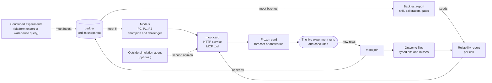

# Concepts

Each term below is used the same way in the commands, the reports and the card. Read the flow first, then use the glossary as a lookup. The [method page](method.md) says how each quantity is computed.

## The flow

Moot Court has one input, one forecast and one feedback loop.

Read it from the left. Concluded experiments become the **ledger**. The ledger trains **models** and is replayed by the **backtest**, which says whether the models can be trusted and how many experiments it takes to tell. A **card** combines a model with the reliability report and either gives a forecast or abstains. The card is frozen, and it names the ledger row that will hold its result (its **row id**). When the live experiment ends, `moot join` finds the card by that row id and attaches the result to it as an **outcome**, and the outcomes become the reliability report that the next card reads. The loop is how the forecaster earns and loses trust.

Nothing in the flow decides anything about the experiment. The card prioritizes and sizes the test. The live test decides.

## Glossary

| Term | In one line | Section |
|---|---|---|
| Ledger | the table of concluded experiments that teaches the models | [Ledger](#ledger) |
| Contrast | one row of the ledger: one variant against its baseline on one metric | [Ledger](#ledger) |
| Cell | a group of alike experiments sharing a base rate | [Cell](#cell) |
| Origin | a point in time; a model sees only rows usable by then | [Origin](#origin) |
| `usable_after` | the first instant a row may be used for a forecast | [Origin](#origin) |
| Rung (P0, P1, P2, P3) | one predictor of the ladder | [Ladder](#ladder) |
| Second opinion | an outside agent's probability, held at weight zero until it earns more | [Second opinion](#second-opinion) |
| Abstention triggers | the four reasons a card declines: support, novelty, reliability, instability | [Abstention](#abstention) |
| Card | the frozen forecast for one proposed experiment | [Card](#card) |
| Row id | the ledger row a card will be joined to, `source:test_id:variant_id` | [Card](#row-id) |
| Skill line | the card's own record: recent skill with its interval and the gate verdict | [Card](#the-skill-line) |
| Champion and challenger | the model cards use and the newer fit that may replace it | [Champion and challenger](#champion-and-challenger) |
| Frozen ids | content digests that make a card, a model and a snapshot tamper-evident | [Frozen ids](#frozen-ids) |
| Harness | the rolling-origin backtest | [Harness](#harness) |
| Gate | the number of scored experiments below which a difference cannot be told from zero | [Gates](#gates) |
| Decision value | how much lift a policy that follows the forecast would have captured | [Decision value](#decision-value) |
| Report card | the one-page, shareable summary of a backtest | [Report card](#report-card) |
| Reliability report | the recent hit record per cell that cards read | [Reliability report](#reliability-report) |

## Ledger

The ledger is the record of concluded experiments, one row per **contrast**: one variant against its baseline on one metric at the final read. A row holds the estimated effect `y`, its standard error `s`, the planned exposure per arm, the time the test started, the time its result became final and the time it may be used (`usable_after`). Rows carry a status. Only admitted rows may teach a model; the others (an arm with too few units, a sample ratio mismatch, a duplicate arm) are kept and counted, never dropped. Snapshots of the ledger are immutable and named by a digest of their content. The file format is in [Ledger format](ledger-format.md).

## Cell

A cell is a group of experiments that are alike enough to share a base rate and a spread of true effects, for example headline-only changes or checkout conversion. By default the cell is the metric. Every prediction is made inside a cell, and every score is reported by cell and pooled. A cell with fewer than 30 admitted rows visible at the origin makes a card abstain.

## Origin

An origin is a point in time. A model at an origin sees only rows whose `usable_after` is not later than the origin. A card is issued at an origin, and a backtest steps through quarterly origins so that each row is forecast by models that could not have seen it.

`usable_after` is the first instant a forecaster may use a row. It defaults to the end of the analysis window plus the delay you give at import (`--usable-delay-days`). It exists because a result is often not final, or not available to the team, the moment a window closes. Using a row before it is usable is the leak that makes backtests look better than they are, so every command respects it, and `moot ledger check` reports a row whose dates break it.

## Ladder

The ladder is a sequence of predictors, called **rungs**. The rungs are not a nested chain. Each adds one thing to the one below it:

- **P0** is the empirical base-rate forecaster of the cell. Its probability of a significant positive result is the cell's visible event rate, the quantity that Brier skill is measured against, so its skill is zero by construction. Its intervals are the quantiles of the visible estimates. It is the floor, and it never models measurement error: the estimates it summarizes already contain it.
- **P1** adds a fitted partially pooled Student-t prior that accounts for measurement error. It pools the cells and shrinks each toward the whole, weighing every row by its own standard error, so a noisy experiment counts for less.
- **P2** adds kernel-weighted precedents under an admission guard: it weighs past experiments that resemble the proposal (a kernel regression on the proposal's features), shrunk toward P1, with a weight on precedents chosen per cell. Its predictive is a Student-t of the same family as P1, with the cell's own degrees of freedom, so a change in the weight changes the location and the scale and never the family. At a weight of zero P2 equals P1 exactly.
- **P3** is the team's own forecast, when one is supplied with the request, frozen at issue. No public archive holds one, so it is exercised on synthetic data only.

The **admission guard** decides when P2 may use a weight above zero. For each cell and origin it scores every candidate weight on validation rows inside the fit and admits a weight only if its gain in log score over a weight of zero, minus two standard errors (clustered by test), is above zero. Otherwise the weight is zero and P2 reduces to P1. The guard limits how much noise the selection can fit, and it is a weak limit. It does not promise that P2 beats P1 on later tests, and the results show that on the Upworthy archive it does not: P2 can score below P1 out of time, by a few thousandths of a nat. The positive-control table in the [results](results.md) shows the cause: with 3,700 tests in the ledger, about the size of the Upworthy headline-only cell, the guard admits a weight in most cells even when no signal is planted, so an admitted weight is not evidence that precedents help. This is a known limitation of the guard, which the multiplier of two standard errors does not remove. The reports say how often the guard held the weight at zero, and the [results page](results.md) shows guarded and unguarded selection side by side.

Challengers (gradient boosting, local empirical Bayes, a text-only classifier) run beside the ladder on the same rows and never replace it without winning on the promotion rule. Each also has a recalibrated row, whose probability goes through a map fit on the rows visible at the origin only.

### Second opinion

An outside agent that gives a probability for the same event, attached without a code change. It is scored on the backtest beside the model and held at weight zero until it beats the model on origins it was not tuned on. See [Simulators](simulators.md) and [tutorial 6](tutorials/06-simulation-agent.md).

## Abstention

Abstention is the court declining to rule. A card abstains when any one of four **triggers** fires:

| Trigger | Fires when |
|---|---|
| support | the cell has fewer than 30 admitted rows visible at the origin |
| novelty | the proposal is unlike every precedent: its similarity to the cell's rows is below the 5th percentile of what the cell's own rows have to each other |
| reliability | the cell's reliability report is missing, more than 14 days old at the card's issue time, or marks the cell drifted (two joins in a row with at least ten outcomes in the window and a rolling log score more than 0.10 nats under the base rate) |
| instability | resampling the precedents by experiment keeps the forecast on the same side of the action threshold in 80 percent or fewer of the resamples |

An abstained card says which reasons fired and shows the base-rate forecast only. It still keeps the forecast it withheld, sealed in its frozen file, and the weekly join scores that forecast like any other card's (see [the card](#card)), so a cell that abstains for a stale record collects the evidence it needs to recover. The abstention rate is reported with every score, so a forecaster cannot look good by declining everything without that showing.

## Card

A card is a pre-trial opinion for one proposed test: the probability that it ends significant and positive, an interval for the true effect, the precedents that carry the forecast, how far the answer is from changing a decision, how well forecasts like it did, and the abstention status. A card never contains a ship, rollout or stopping recommendation. Cards are frozen as content-addressed files, so a card cannot be edited after the outcome is known. The fields are listed in the [card reference](reference/card.md).

The prediction block of a card (schema version 2) stores the forecast itself: the family of the predictive (a Student-t), its degrees of freedom, location and scale, the grid it was computed on and the planned standard error. It gives two intervals at each level. The interval for the true effect is what the team reads. The interval for the observed estimate adds the noise the test will have at its planned standard error, so it is wider, and it is the interval that a result is compared with and that the backtest's coverage is measured against. The weekly join scores a card from its stored predictive, so a joined card has the same log score as the backtest gives the same row.

### Row id

A card can name the ledger row that will hold its result, `source:test_id:variant_id`, so that the weekly join can find it. Give it as `--row-id` on `moot card` (or `--test-id` with `--variant-id`, which compose the same id), as the `row_id` field of `POST /card`, and as the `row_id` argument of the MCP tool `get_card`. A card without a row id is frozen and valid, but no join can attach an outcome to it. The MCP tool never freezes a card, so it only echoes the key. The request also takes the planned exposure of the variant arm apart from the reference arm (`--impressions-variant`) and the reference headline (`--reference-headline`).

### The skill line

Every card carries the **skill line**: the trailing eight-week Brier skill of recent cards against the cell base rate, with its 90 percent interval by test, the rows and tests it rests on, the gate verdict at that many tests (read at the base rate nearest the cell's own) and the latest gated figure of the model's backtest with its interval. A record with too few tests says "undecidable at this n"; a report written before the intervals were stored says that no interval is recorded.

### Abstained cards keep a sealed forecast

When a card abstains, it keeps the forecast it withheld in a sealed block of its frozen file. No renderer, HTTP response or tool shows it, so an abstained card still shows only the base rate. The weekly join scores it with the same function as an issued card, flags it as abstained, and feeds it to the reliability report. Without that, abstention would be absorbing: a stale cell would abstain every card, the abstained cards would add no evidence, and the cell could never refresh.

## Frozen ids

Three ids are content digests, written as hexadecimal strings: the **card id** (a digest of the card's content), the **model id** (of the fitted parameters) and the **snapshot id** (of the ledger rows, prefixed with the date). A card stores the ids of the snapshot and the model it used. If the content changes, the id changes, and a card whose id clashes with different content under the same id is refused. The consequence for users: compare a card by its stored ids, never by refitting and recomputing them. A fit repeated on another operating system or linear algebra build can differ in the last bits of its parameters and so in its model id and feature hash, while scores agree to about eleven digits. See [troubleshooting](troubleshooting.md#ids-differ-between-machines).

## Harness

The harness is the rolling-origin backtest. It scores every admitted row once per rung with models fitted only on earlier rows, then reports log score, CRPS, Brier skill against the base rate, calibration, coverage, abstention and decision value, with intervals bootstrapped by test. Beside each 90 percent interval the aggregate rows carry Bonferroni-adjusted bounds for the whole table of intervals, because a table of many cells and rungs will show some intervals that exclude zero by chance. The calibration test draws its null by test, not by row, because the contrasts of one test share a baseline. Coverage is reported by decile of planned exposure and by decile of the realized over the planned standard error: it is near the stated level on average and not within every group, and the second table shows where it is not. The report header counts the tests in the ledger, the tests admitted and the tests scored, and says why they differ.

## Gates

A gate is a number of scored tests below which a difference in skill cannot be told from zero. Gates come from a power simulation and are read at two power targets: 0.90 for release decisions and 0.80 as a research screen. A comparison below its gate is reported as undecidable at this n. The gate counts tests, not rows, because contrasts of one test share a baseline and are not independent.

How many tests a gate needs depends on how often a test ends significant and positive, the base rate. `moot simulate gate-power` draws simulated ledgers at several base rates (0.09, 0.14 and 0.30 by default), bootstraps by test and writes the sizes for each into `reports/gates.json`, in tests, with the 90 percent by-test interval it used. A backtest reads each cell's gate at the simulated base rate nearest the cell's own event rate and keeps the earlier base rate of 0.30 beside it as a second verdict. `moot init` writes a quick gates file and `moot simulate power` the per-row simulation that earlier releases used; both are kept for comparison, and a backtest that finds one of them says so.

## Decision value

Decision value asks a different question from calibration: if a team had chosen the top quarter of its tests by a rung's forecast, how much of the total positive lift would it have captured, compared with choosing at random and with an oracle? It is reported at budgets of 10, 25 and 50 percent of the tests. Random order is computed exactly (it captures the budget's share of the total), and every policy row carries a 90 percent interval by test and its difference from random order, so a policy whose interval for the difference contains zero has shown no edge. A rung whose win probability is the same for every test in a cell can only choose between cells, and the table says so. It is reported apart from the scores and never folded into them.

## Champion and challenger

The **champion** is the model that cards use. A fit records the method it was made with (`method_id`, a hash of the method version and its fixed hyperparameters, never of the data). A fit with the champion's `method_id` on strictly newer data is the same method on newer data, and it may refresh the champion without the promotion margin, after a no-regression check on its backtest: it is refused, and kept as a challenger with the reason in the registry history, when its backtest Brier skill interval lies entirely below the champion's. Until the backtest of the fit is attached, the refresh is pending, which is why the backtest follows the fit. A fit with another `method_id` is a different method. It stays a challenger until `moot promote` finds that its Brier skill beats the champion's by the margin on a backtest that meets the gate. Without the split, a method whose skill is near zero could never replace a champion that was merely older.

## Report card

The report card is the one-page summary that `moot benchmark --ledger` writes: ledger size, gates, the ladder's skill and coverage, decision value and calibration by precision. It holds aggregates only, so an organization can keep its ledger private and publish the card. See [the benchmark page](benchmark.md).

## Reliability report

The reliability report holds, per cell, the rolling log score and Brier skill of recently issued cards over the trailing eight weeks, the interval and the number of tests behind the skill, and whether the cell has drifted. A cell drifts when, at two joins in a row, its rolling log score is more than 0.10 nats under the base rate with at least ten outcomes in the window; the mark clears at the first join that is not below. The backtest seeds the report, and `moot join` keeps it current, abstained cards included. A card reads it, which is how the record of past cards changes what the next card does. See [tutorial 4](tutorials/04-weekly-loop.md).
