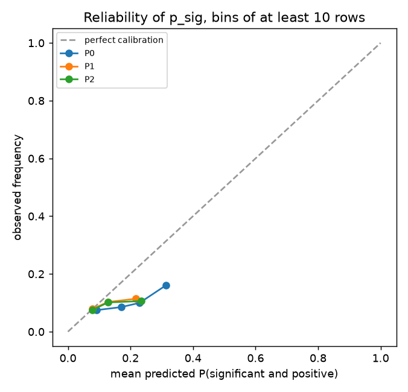
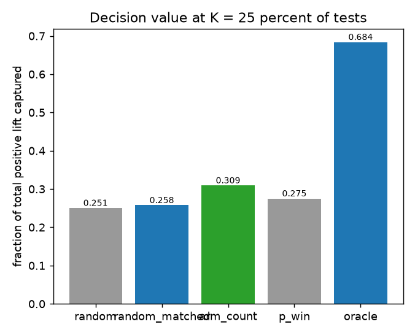
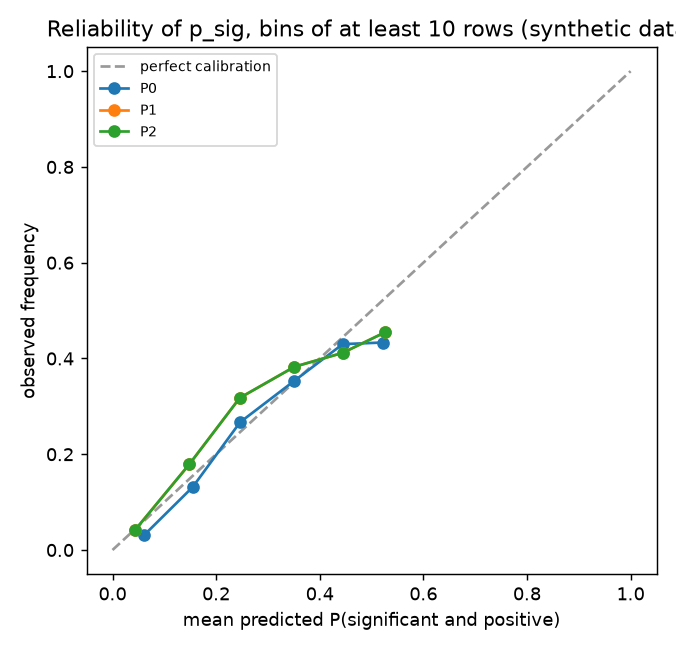
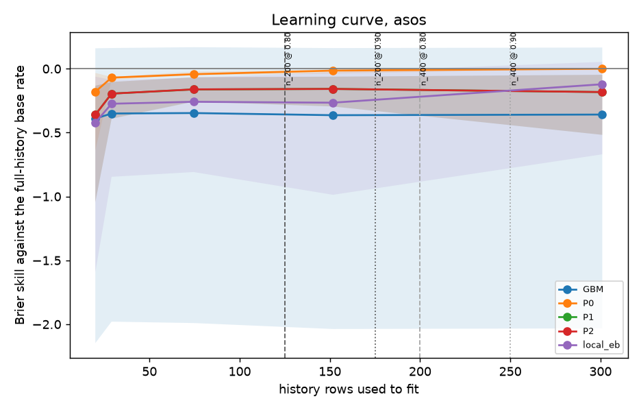
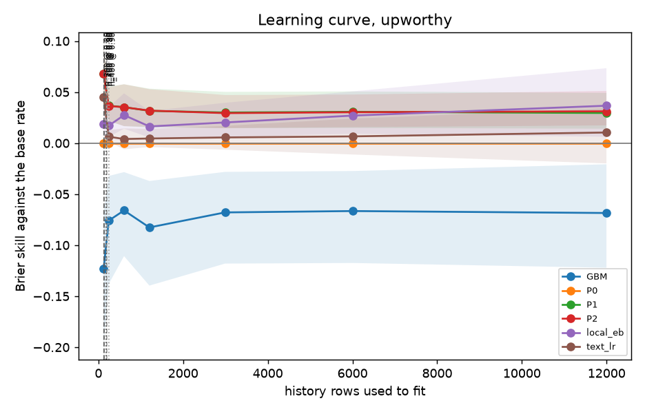

# Results

These tables are produced by the commands of [tutorial 3](tutorials/03-reproduce-upworthy.md) and the `make` targets it lists, and rendered from the report files by `scripts/render_readme_results.py`. Nulls are reported as nulls. Every number here comes from the rerun after the round 00 review, which fixed P0, the P2 predictive, the gates and the live join; [Method](method.md) (calls 160 to 179) lists what changed. The current numbers are run 8 (`paper/data/run8-randomization-window`), which leaves out the tests in the archive's discouraged randomization window ([`DATA.md`](https://github.com/journey-agents/mootcourt/blob/main/DATA.md)), and every number is exploratory.

The first full run scored Upworthy on a relative lift against a noisy reference arm, with the realized standard error as the forecaster's scale, and every rung had negative skill. That was a design defect, not a finding about the archive. The effect is now the absolute click-through difference in percentage points, and the forecaster's scale and features use only what is known before launch. [Method](method.md) (calls 52 to 55) tells the story with the numbers.

## How to read the tables

- **Rungs.** P0 is the empirical base-rate forecaster of the cell, P1 adds a fitted partially pooled Student-t prior that accounts for measurement error, and P2 adds kernel-weighted precedents under an admission guard. `always_reference` and `always_variant` are direction baselines. The challengers (GBM, local_eb, text_lr) are rungs of the same report, each with a raw row and a recalibrated one (`+cal`). See [concepts](concepts.md#ladder).
- **Brier skill** is one minus the rung's Brier score over the Brier score of a constant base rate. Zero is no better than the base rate; the interval is a 90 percent bootstrap interval that resamples whole tests. An interval that contains zero means the data cannot tell the rung from the base rate. P0 is that base rate, so its skill is zero by construction and its interval has no width. The pooled table also gives Bonferroni-adjusted bounds, which cover every interval of the table at once.
- **Decidable** says whether the number of scored tests reaches the gate, so that a skill difference of 0.20 or 0.10 could be told from zero. The gate is sized by test at the simulated base rate nearest the cell's own; one column keeps the earlier base rate of 0.3. "Undecidable at this n" is not a negative result. See [gates](concepts.md#gates).
- **Coverage 80% / 90%** is the share of outcomes inside the central intervals for the observed estimate. Near 0.80 and 0.90 is calibrated. It holds on average and not within every group: the table by decile of the realized over the planned standard error shows where it does not.
- **AUC and resolution** measure discrimination apart from skill. AUC is whether the forecasts rank rows with the event above rows without it. Resolution is the Murphy term of the Brier score: how far the event frequencies of equal-mass forecast bins lie from the overall rate; it is zero for a forecaster that gives every row the same probability, and it is not the spread of the forecasts. A rung can have a Brier skill of zero and still discriminate, or the reverse. The same table scores the forecast against the event defined on the planned standard error; the headline Brier skill stays on the realized event.
- **Guard pairs** list every cell and origin where the admission guard allowed a weight on precedents, with the gain it saw in selection and what the next quarter gave.
- **Abstention rate** is the share of rows on which a card would have declined. It is reported with every score.
- **Decision value** is reported at a budget of 25 percent of the tests, with the difference from random order and its interval. A difference whose interval contains zero is no edge.

## The tables

<!-- moot-results:start -->
_Generated by `scripts/render_readme_results.py` from the report JSON files. Do not edit by hand. Intervals are 90 percent bootstrap intervals that resample whole tests._

### Upworthy backtest

Snapshot 20261106-2dc461f52ea4, model 938be3f002b0, seed 0. 10697 rows scored over 7 quarterly origins out of 10903 admitted. Command: `moot backtest --source upworthy --origins quarterly --challenger gbm --challenger local_eb --challenger text_lr --seed 0`.

Tests: 4873 in the ledger, 3022 admitted, 2949 scored. Tests in the ledger are the distinct test ids of every row of the source whatever its status. Tests admitted are the distinct test ids with at least one admitted contrast. Tests scored are the admitted tests with at least one contrast scored by the primary rung. The difference between admitted and scored is the contrasts of the first quarters, before the first origin with enough visible rows to fit (they are history only), plus any test whose contrasts all fall there.

P2 admission guard: 2.0 standard errors.

| cell | rung | n | log score | Brier skill (90% interval) | decidable by tests (0.90 gate, at the cell's base rate) | gate base rate | decidable by tests (0.90 gate, base rate 0.3) | decidable by rows (0.90 gate, overstates) | decidable by tests (0.80 screen) | coverage 80% / 90% | abstention rate |
|---|---|---|---|---|---|---|---|---|---|---|---|
| ALL | P0 | 10697 | -0.8762 | 0.0000 (0.0000 to 0.0000) | yes, both skills | 0.09 | yes, both skills | yes, both skills | yes, both skills | 0.8460 / 0.9331 | 0.3179 |
| ALL | P1 | 10697 | -0.7566 | 0.0023 (-0.0012 to 0.0061) | yes, both skills | 0.09 | yes, both skills | yes, both skills | yes, both skills | 0.8113 / 0.8956 | 0.3179 |
| ALL | P2 | 10697 | -0.7565 | 0.0032 (-0.0004 to 0.0072) | yes, both skills | 0.09 | yes, both skills | yes, both skills | yes, both skills | 0.8094 / 0.8933 | 0.3179 |
| both | P0 | 370 | -1.2495 | 0.0000 (0.0000 to 0.0000) | undecidable | 0.09 | yes, both skills | undecidable | skill 0.20 only | 0.7919 / 0.9135 | 0.2919 |
| both | P1 | 370 | -1.0197 | -0.0049 (-0.0259 to 0.0140) | undecidable | 0.09 | yes, both skills | undecidable | skill 0.20 only | 0.7703 / 0.8676 | 0.2919 |
| both | P2 | 370 | -1.0197 | -0.0049 (-0.0259 to 0.0140) | undecidable | 0.09 | yes, both skills | undecidable | skill 0.20 only | 0.7703 / 0.8676 | 0.2919 |
| headline_only | P0 | 5966 | -0.8885 | 0.0000 (0.0000 to 0.0000) | yes, both skills | 0.09 | yes, both skills | yes, both skills | yes, both skills | 0.8639 / 0.9418 | 0.2162 |
| headline_only | P1 | 5966 | -0.7614 | -0.0014 (-0.0054 to 0.0027) | yes, both skills | 0.09 | yes, both skills | yes, both skills | yes, both skills | 0.8186 / 0.9071 | 0.2162 |
| headline_only | P2 | 5966 | -0.7612 | 0.0001 (-0.0041 to 0.0044) | yes, both skills | 0.09 | yes, both skills | yes, both skills | yes, both skills | 0.8153 / 0.9031 | 0.2162 |
| image_only | P0 | 4361 | -0.8278 | 0.0000 (0.0000 to 0.0000) | yes, both skills | 0.09 | yes, both skills | yes, both skills | yes, both skills | 0.8262 / 0.9227 | 0.4593 |
| image_only | P1 | 4361 | -0.7276 | 0.0099 (0.0034 to 0.0170) | yes, both skills | 0.09 | yes, both skills | yes, both skills | yes, both skills | 0.8046 / 0.8821 | 0.4593 |
| image_only | P2 | 4361 | -0.7276 | 0.0099 (0.0034 to 0.0170) | yes, both skills | 0.09 | yes, both skills | yes, both skills | yes, both skills | 0.8046 / 0.8821 | 0.4593 |

P0 is the empirical base-rate forecaster, so its Brier skill is zero by construction and its interval has no width. The gate columns read the number of scored tests against the gate sized at the base rate nearest the cell's own. A column for the earlier convention (base rate 0.3) or for the by-row verdict appears only when it says something the first column does not.

P2 Brier skill against the base rate on all rows: 0.0032 (-0.0004 to 0.0072), which is not distinguishable from the constant base rate. Its calibration error is 0.0135, at percentile 100.0 of the clustered perfect-calibration null. P0 is the base-rate forecaster the skill is measured against, so its skill is zero by construction.

Reliability bins: P2 rows predicted between 0.10 and 0.20 (4675 rows, mean predicted 0.1291) were followed by a significant positive result 0.1003 of the time.

Log score on all rows: P0 -0.8762, P1 -0.7566, P2 -0.7565. P2 minus P1 is +0.0001, so the precedent rung adds nothing measurable over the prior.

Percentile intervals beside Bonferroni-adjusted bounds, all cells pooled. The adjusted bounds cover every interval of the aggregate table at once (its family size is in the last column); the pooled interval is the primary claim, a rule fixed after the data were seen, and the per-cell intervals are descriptive.

| rung | tests | Brier skill (90% interval) | Brier skill, adjusted bounds | log score (90% interval) | log score, adjusted bounds | intervals in the family |
|---|---|---|---|---|---|---|
| P0 | 2949 | 0.0000 (0.0000 to 0.0000) | n/a to n/a | -0.8762 (-0.9037 to -0.8508) | -0.9256 to -0.8269 | 52 |
| P1 | 2949 | 0.0023 (-0.0012 to 0.0061) | -0.0044 to 0.0090 | -0.7566 (-0.7813 to -0.7348) | -0.8001 to -0.7130 | 52 |
| P2 | 2949 | 0.0032 (-0.0004 to 0.0072) | -0.0039 to 0.0103 | -0.7565 (-0.7811 to -0.7346) | -0.8003 to -0.7127 | 52 |

Calibration error of `p_sig`, all cells pooled. The percentile is read in a perfect-calibration null that draws the contrasts of one test together (500 draws, so 100 means above every draw); the independent null draws every row alone and is kept for comparison.

| rung | ECE | percentile, clustered null | percentile, independent null | equal-mass ECE | percentile, equal-mass | design effect | within-test correlation |
|---|---|---|---|---|---|---|---|
| P0 | 0.0194 | 100.0 | 100.0 | 0.0282 | 100.0 | 1.37 | 0.1193 |
| P1 | 0.0140 | 100.0 | 100.0 | 0.0179 | 100.0 | 1.44 | 0.1409 |
| P2 | 0.0135 | 100.0 | 100.0 | 0.0182 | 100.0 | 1.46 | 0.1469 |

Discrimination apart from skill, all cells pooled. AUC is the chance that a row with the event gets a higher `p_sig` than a row without it (0.5 is no discrimination); resolution is the Murphy term of the Brier score: how far the observed event frequencies of equal-mass forecast bins lie from the overall event rate (zero when every bin has the overall rate, and not a measure of how much the forecasts vary). The last columns score the same forecast against the event defined on the planned standard error instead of the realized one; the headline skill stays on the realized event.

| rung | AUC of the event (90% interval) | resolution of the event | event rate, realized standard error | event rate, planned standard error | Brier skill on the planned event (90% interval) |
|---|---|---|---|---|---|
| GBM | 0.5605 (0.5383 to 0.5790) | 0.00031 | 0.1681 (mean `p_sig`) | 0.0778 | -0.1126 (-0.1280 to -0.0968) |
| GBM+cal | 0.5476 (0.5261 to 0.5660) | 0.00021 | 0.1116 (mean `p_sig`) | 0.0778 | -0.0075 (-0.0117 to -0.0030) |
| P0 | 0.5610 (0.5391 to 0.5791) | 0.00062 | 0.1141 (mean `p_sig`) | 0.0778 | 0.0000 (0.0000 to 0.0000) |
| P1 | 0.5562 (0.5340 to 0.5738) | 0.00027 | 0.0994 (mean `p_sig`) | 0.0778 | 0.0046 (0.0008 to 0.0083) |
| P2 | 0.5591 (0.5373 to 0.5764) | 0.00032 | 0.0978 (mean `p_sig`) | 0.0778 | 0.0058 (0.0018 to 0.0095) |
| local_eb | 0.5460 (0.5250 to 0.5653) | 0.00047 | 0.1051 (mean `p_sig`) | 0.0778 | -0.0172 (-0.0245 to -0.0104) |
| local_eb+cal | 0.5471 (0.5242 to 0.5668) | 0.00033 | 0.1085 (mean `p_sig`) | 0.0778 | 0.0029 (0.0003 to 0.0060) |
| text_lr | 0.5763 (0.5543 to 0.5958) | 0.00065 | 0.0935 (mean `p_sig`) | 0.0778 | 0.0159 (0.0082 to 0.0238) |
| text_lr+cal | 0.5811 (0.5608 to 0.5999) | 0.00053 | 0.1079 (mean `p_sig`) | 0.0778 | 0.0078 (0.0034 to 0.0121) |

Calibration by precision: rows in deciles of planned exposures per arm (fewer groups when exposures tie). A forecaster calibrated overall but not within these groups is not calibrated; `mean p_sig` should match `event rate` and `coverage 90%` should be near 0.90 in every group.

| rung | decile | planned exposures per arm | n | mean s_star | mean p_sig | event rate | coverage 90% |
|---|---|---|---|---|---|---|---|
| P1 | 1 | 1167 to 2228 | 1068 | 0.3739 | 0.0737 | 0.0637 | 0.8624 |
| P1 | 2 | 2229 to 2684 | 1072 | 0.3434 | 0.0929 | 0.0774 | 0.8694 |
| P1 | 3 | 2685 to 2900 | 1069 | 0.3139 | 0.0923 | 0.0739 | 0.8746 |
| P1 | 4 | 2900 to 3060 | 1069 | 0.3035 | 0.0853 | 0.1048 | 0.8849 |
| P1 | 5 | 3060 to 3204 | 1067 | 0.3007 | 0.0851 | 0.0862 | 0.8885 |
| P1 | 6 | 3204 to 3556 | 1073 | 0.2981 | 0.1005 | 0.0848 | 0.8928 |
| P1 | 7 | 3556 to 3893 | 1068 | 0.2804 | 0.1056 | 0.1011 | 0.9054 |
| P1 | 8 | 3894 to 4385 | 1071 | 0.2646 | 0.1059 | 0.0887 | 0.8936 |
| P1 | 9 | 4387 to 5268 | 1070 | 0.2499 | 0.1192 | 0.0841 | 0.9355 |
| P1 | 10 | 5271 to 15082 | 1070 | 0.2172 | 0.1330 | 0.0888 | 0.9486 |
| P2 | 1 | 1167 to 2228 | 1068 | 0.3739 | 0.0716 | 0.0637 | 0.8577 |
| P2 | 2 | 2229 to 2684 | 1072 | 0.3434 | 0.0911 | 0.0774 | 0.8685 |
| P2 | 3 | 2685 to 2900 | 1069 | 0.3139 | 0.0881 | 0.0739 | 0.8653 |
| P2 | 4 | 2900 to 3060 | 1069 | 0.3035 | 0.0837 | 0.1048 | 0.8821 |
| P2 | 5 | 3060 to 3204 | 1067 | 0.3007 | 0.0842 | 0.0862 | 0.8875 |
| P2 | 6 | 3204 to 3556 | 1073 | 0.2981 | 0.0984 | 0.0848 | 0.8928 |
| P2 | 7 | 3556 to 3893 | 1068 | 0.2804 | 0.1038 | 0.1011 | 0.9026 |
| P2 | 8 | 3894 to 4385 | 1071 | 0.2646 | 0.1053 | 0.0887 | 0.8926 |
| P2 | 9 | 4387 to 5268 | 1070 | 0.2499 | 0.1189 | 0.0841 | 0.9355 |
| P2 | 10 | 5271 to 15082 | 1070 | 0.2172 | 0.1324 | 0.0888 | 0.9486 |

Coverage by decile of the realized over the planned standard error. The forecaster fixes the level of the outcome rate at the cell median, so its planned standard error is too small when the realized rate is higher and too large when it is lower: coverage is near 0.90 on average and not within these groups. The realized standard error is used here to group rows and is never an input of a forecast.

| rung | decile | realized over planned standard error | n | mean ratio | mean p_sig | event rate | coverage 80% | coverage 90% |
|---|---|---|---|---|---|---|---|---|
| P1 | 1 | 0.32 to 0.61 | 1070 | 0.534 | 0.1093 | 0.0336 | 0.9981 | 1.0000 |
| P1 | 2 | 0.61 to 0.70 | 1070 | 0.657 | 0.1042 | 0.0579 | 0.9757 | 0.9944 |
| P1 | 3 | 0.70 to 0.76 | 1069 | 0.731 | 0.0984 | 0.0804 | 0.9336 | 0.9888 |
| P1 | 4 | 0.76 to 0.83 | 1070 | 0.795 | 0.0970 | 0.0757 | 0.8813 | 0.9692 |
| P1 | 5 | 0.83 to 0.89 | 1069 | 0.861 | 0.0935 | 0.0842 | 0.8569 | 0.9439 |
| P1 | 6 | 0.89 to 0.96 | 1070 | 0.926 | 0.0947 | 0.0897 | 0.7981 | 0.9028 |
| P1 | 7 | 0.96 to 1.04 | 1070 | 0.995 | 0.0951 | 0.0963 | 0.7411 | 0.8626 |
| P1 | 8 | 1.04 to 1.13 | 1069 | 1.083 | 0.0979 | 0.1123 | 0.6978 | 0.8316 |
| P1 | 9 | 1.13 to 1.28 | 1070 | 1.200 | 0.0998 | 0.1047 | 0.6654 | 0.7776 |
| P1 | 10 | 1.28 to 2.75 | 1070 | 1.492 | 0.1036 | 0.1187 | 0.5645 | 0.6850 |
| P2 | 1 | 0.32 to 0.61 | 1070 | 0.534 | 0.1087 | 0.0336 | 0.9981 | 1.0000 |
| P2 | 2 | 0.61 to 0.70 | 1070 | 0.657 | 0.1027 | 0.0579 | 0.9757 | 0.9944 |
| P2 | 3 | 0.70 to 0.76 | 1069 | 0.731 | 0.0968 | 0.0804 | 0.9336 | 0.9878 |
| P2 | 4 | 0.76 to 0.83 | 1070 | 0.795 | 0.0956 | 0.0757 | 0.8804 | 0.9682 |
| P2 | 5 | 0.83 to 0.89 | 1069 | 0.861 | 0.0920 | 0.0842 | 0.8569 | 0.9429 |
| P2 | 6 | 0.89 to 0.96 | 1070 | 0.926 | 0.0930 | 0.0897 | 0.7972 | 0.8963 |
| P2 | 7 | 0.96 to 1.04 | 1070 | 0.995 | 0.0935 | 0.0963 | 0.7355 | 0.8607 |
| P2 | 8 | 1.04 to 1.13 | 1069 | 1.083 | 0.0960 | 0.1123 | 0.6913 | 0.8279 |
| P2 | 9 | 1.13 to 1.28 | 1070 | 1.200 | 0.0977 | 0.1047 | 0.6645 | 0.7738 |
| P2 | 10 | 1.28 to 2.75 | 1070 | 1.492 | 0.1017 | 0.1187 | 0.5607 | 0.6813 |

Direction accuracy against its ceiling, every rung and the two direction baselines (always the reference arm, always the variant):

| rung | kind | direction accuracy (90% interval) | ceiling | decisive rows | direction accuracy on decisive rows |
|---|---|---|---|---|---|
| GBM | challenger | 0.5688 (0.5575 to 0.5797) | 0.8174 | 2696 | 0.6413 |
| GBM+cal | challenger | n/a (n/a to n/a) | 0.8174 | 0 | n/a |
| P0 | ladder | 0.5721 (0.5606 to 0.5822) | 0.8174 | 2696 | 0.6447 |
| P1 | ladder | 0.5683 (0.5565 to 0.5791) | 0.8174 | 2696 | 0.6372 |
| P2 | ladder | 0.5706 (0.5591 to 0.5811) | 0.8174 | 2696 | 0.6417 |
| always_reference | baseline | 0.5825 (0.5706 to 0.5936) | 0.8174 | 2696 | 0.6614 |
| always_variant | baseline | 0.4175 (0.4064 to 0.4294) | 0.8174 | 2696 | 0.3386 |
| local_eb | challenger | 0.5453 (0.5351 to 0.5550) | 0.8174 | 2696 | 0.5987 |
| local_eb+cal | challenger | n/a (n/a to n/a) | 0.8174 | 0 | n/a |
| text_lr | challenger | 0.5581 (0.5482 to 0.5676) | 0.8174 | 2696 | 0.5886 |
| text_lr+cal | challenger | n/a (n/a to n/a) | 0.8174 | 0 | n/a |

Abstention by trigger (rows that fired each trigger; a row can fire several):

| cell | rows | abstention rate | support | novelty | reliability | instability |
|---|---|---|---|---|---|---|
| ALL | 10697 | 0.3179 | 280 | 1549 | 1915 | 0 |
| both | 370 | 0.2919 | 67 | 20 | 88 | 0 |
| headline_only | 5966 | 0.2162 | 0 | 226 | 1086 | 0 |
| image_only | 4361 | 0.4593 | 213 | 1303 | 741 | 0 |

Never fired in this backtest: instability. After the burn-in origin the reliability trigger fired on 1236 rows.

Decision value at a budget of 25 percent of the tests (budgets of 10 and 50 percent are in the report), pooled over origins. Random order captures K over n of the total positive lift exactly. Intervals are 90 percent bootstrap intervals that resample whole tests within each origin. A rung whose win probability is constant within a cell chooses by cell and then at random.

| policy | rung | captured fraction (90% interval) | difference from random order (90% interval) | chooses by cell only |
|---|---|---|---|---|
| random | all | 0.2505 (0.2505 to 0.2505) | +0.0000 (+0.0000 to +0.0000) | n/a |
| p_win | GBM | 0.2768 (0.2604 to 0.2969) | +0.0263 (+0.0099 to +0.0464) | no |
| p_win | P0 | 0.2497 (0.2405 to 0.2586) | -0.0008 (-0.0100 to +0.0080) | yes |
| p_win | P1 | 0.2490 (0.2384 to 0.2592) | -0.0015 (-0.0121 to +0.0087) | yes |
| p_win | P2 | 0.2752 (0.2597 to 0.2885) | +0.0247 (+0.0091 to +0.0380) | no |
| p_win | local_eb | 0.2791 (0.2591 to 0.2954) | +0.0286 (+0.0085 to +0.0449) | no |
| p_win | text_lr | 0.3070 (0.2884 to 0.3263) | +0.0565 (+0.0379 to +0.0758) | no |
| oracle | all | 0.6839 (0.6711 to 0.6955) | +0.4334 (+0.4205 to +0.4450) | n/a |
| random_matched | GBM | 0.2596 (0.2555 to 0.2640) | +0.0091 (+0.0050 to +0.0135) | n/a |
| random_matched | P0 | 0.2517 (0.2490 to 0.2546) | +0.0012 (-0.0016 to +0.0041) | n/a |
| random_matched | P1 | 0.2525 (0.2495 to 0.2556) | +0.0020 (-0.0010 to +0.0051) | n/a |
| random_matched | P2 | 0.2577 (0.2547 to 0.2621) | +0.0072 (+0.0042 to +0.0116) | n/a |
| arm_count | all | 0.3093 (0.2940 to 0.3251) | +0.0588 (+0.0435 to +0.0746) | n/a |
| random_matched | local_eb | 0.2608 (0.2556 to 0.2654) | +0.0103 (+0.0050 to +0.0149) | n/a |
| random_matched | text_lr | 0.2613 (0.2574 to 0.2664) | +0.0108 (+0.0069 to +0.0159) | n/a |

Decision value, a quarter of the tests, pooled over origins: random order captures 0.2505 of the total positive observed lift, choosing by P2 p_win captures 0.2752 (a difference from random order of +0.0247, interval +0.0091 to +0.0380), and an oracle that knows the result captures 0.6839.

### ASOS backtest

Snapshot 20261103-6bb5a15c5ff0, model d3e813b146ce, seed 0. 337 rows scored over 7 quarterly origins out of 381 admitted. Command: `moot backtest --source asos --origins quarterly --challenger gbm --challenger local_eb --seed 0`.

Tests: 78 in the ledger, 78 admitted, 68 scored. Tests in the ledger are the distinct test ids of every row of the source whatever its status. Tests admitted are the distinct test ids with at least one admitted contrast. Tests scored are the admitted tests with at least one contrast scored by the primary rung. The difference between admitted and scored is the contrasts of the first quarters, before the first origin with enough visible rows to fit (they are history only), plus any test whose contrasts all fall there.

P2 admission guard: 2.0 standard errors.

| cell | rung | n | log score | Brier skill (90% interval) | decidable by tests (0.90 gate, at the cell's base rate) | gate base rate | decidable by rows (0.90 gate, overstates) | decidable by tests (0.80 screen) | coverage 80% / 90% | abstention rate |
|---|---|---|---|---|---|---|---|---|---|---|
| ALL | P0 | 337 | 4.3405 | 0.0000 (0.0000 to 0.0000) | undecidable | 0.14 | undecidable | undecidable | 0.7478 / 0.8309 | 0.4570 |
| ALL | P1 | 337 | 4.7088 | -0.1073 (-0.2366 to -0.0020) | undecidable | 0.14 | undecidable | undecidable | 0.7834 / 0.8605 | 0.4570 |
| ALL | P2 | 337 | 4.7088 | -0.1073 (-0.2366 to -0.0020) | undecidable | 0.14 | undecidable | undecidable | 0.7834 / 0.8605 | 0.4570 |
| metric_1 | P0 | 85 | 4.0390 | 0.0000 (0.0000 to 0.0000) | undecidable | 0.14 | undecidable | undecidable | 0.7294 / 0.8000 | 0.3647 |
| metric_1 | P1 | 85 | 4.5829 | -0.1882 (-0.3771 to -0.0502) | undecidable | 0.14 | undecidable | undecidable | 0.7647 / 0.8471 | 0.3647 |
| metric_1 | P2 | 85 | 4.5829 | -0.1882 (-0.3771 to -0.0502) | undecidable | 0.14 | undecidable | undecidable | 0.7647 / 0.8471 | 0.3647 |
| metric_2 | P0 | 84 | 4.2308 | 0.0000 (0.0000 to 0.0000) | undecidable | 0.14 | undecidable | undecidable | 0.7738 / 0.8214 | 0.4881 |
| metric_2 | P1 | 84 | 4.6290 | -0.1629 (-0.3450 to -0.0545) | undecidable | 0.14 | undecidable | undecidable | 0.7738 / 0.8690 | 0.4881 |
| metric_2 | P2 | 84 | 4.6290 | -0.1629 (-0.3450 to -0.0545) | undecidable | 0.14 | undecidable | undecidable | 0.7738 / 0.8690 | 0.4881 |
| metric_3 | P0 | 84 | 4.5220 | 0.0000 (0.0000 to 0.0000) | undecidable | 0.14 | undecidable | undecidable | 0.7262 / 0.8571 | 0.4881 |
| metric_3 | P1 | 84 | 4.7879 | -0.1200 (-0.3727 to 0.0184) | undecidable | 0.14 | undecidable | undecidable | 0.7738 / 0.8571 | 0.4881 |
| metric_3 | P2 | 84 | 4.7879 | -0.1200 (-0.3727 to 0.0184) | undecidable | 0.14 | undecidable | undecidable | 0.7738 / 0.8571 | 0.4881 |
| metric_4 | P0 | 84 | 4.5737 | 0.0000 (0.0000 to 0.0000) | undecidable | 0.14 | undecidable | undecidable | 0.7619 / 0.8452 | 0.4881 |
| metric_4 | P1 | 84 | 4.8371 | 0.0201 (-0.0611 to 0.1268) | undecidable | 0.14 | undecidable | undecidable | 0.8214 / 0.8690 | 0.4881 |
| metric_4 | P2 | 84 | 4.8371 | 0.0201 (-0.0611 to 0.1268) | undecidable | 0.14 | undecidable | undecidable | 0.8214 / 0.8690 | 0.4881 |

P0 is the empirical base-rate forecaster, so its Brier skill is zero by construction and its interval has no width. The gate columns read the number of scored tests against the gate sized at the base rate nearest the cell's own. A column for the earlier convention (base rate 0.3) or for the by-row verdict appears only when it says something the first column does not.

P2 Brier skill against the base rate on all rows: -0.1073 (-0.2366 to -0.0020), which is worse than the constant base rate. Its calibration error is 0.1271, at percentile 98.8 of the clustered perfect-calibration null. P0 is the base-rate forecaster the skill is measured against, so its skill is zero by construction.

Reliability bins: P2 rows predicted between 0.10 and 0.20 (86 rows, mean predicted 0.1426) were followed by a significant positive result 0.1860 of the time.

Log score on all rows: P0 4.3405, P1 4.7088, P2 4.7088. P2 minus P1 is +0.0000, so the precedent rung adds nothing measurable over the prior.

Percentile intervals beside Bonferroni-adjusted bounds, all cells pooled. The adjusted bounds cover every interval of the aggregate table at once (its family size is in the last column); the pooled interval is the primary claim, a rule fixed after the data were seen, and the per-cell intervals are descriptive.

| rung | tests | Brier skill (90% interval) | Brier skill, adjusted bounds | log score (90% interval) | log score, adjusted bounds | intervals in the family |
|---|---|---|---|---|---|---|
| P0 | 68 | 0.0000 (0.0000 to 0.0000) | n/a to n/a | 4.3405 (3.9665 to 4.6479) | 3.7150 to 4.9660 | 55 |
| P1 | 68 | -0.1073 (-0.2366 to -0.0020) | -0.3258 to 0.1113 | 4.7088 (4.4240 to 4.9724) | 4.1850 to 5.2327 | 55 |
| P2 | 68 | -0.1073 (-0.2366 to -0.0020) | -0.3258 to 0.1113 | 4.7088 (4.4240 to 4.9724) | 4.1850 to 5.2327 | 55 |

Calibration error of `p_sig`, all cells pooled. The percentile is read in a perfect-calibration null that draws the contrasts of one test together (500 draws, so 100 means above every draw); the independent null draws every row alone and is kept for comparison.

| rung | ECE | percentile, clustered null | percentile, independent null | equal-mass ECE | percentile, equal-mass | design effect | within-test correlation |
|---|---|---|---|---|---|---|---|
| P0 | 0.0435 | 64.9 | 86.6 | 0.0526 | 35.8 | 2.89 | 0.3789 |
| P1 | 0.1271 | 98.8 | 100.0 | 0.1447 | 99.6 | 3.82 | 0.5652 |
| P2 | 0.1271 | 98.8 | 100.0 | 0.1447 | 99.6 | 3.82 | 0.5652 |

Discrimination apart from skill, all cells pooled. AUC is the chance that a row with the event gets a higher `p_sig` than a row without it (0.5 is no discrimination); resolution is the Murphy term of the Brier score: how far the observed event frequencies of equal-mass forecast bins lie from the overall event rate (zero when every bin has the overall rate, and not a measure of how much the forecasts vary). The last columns score the same forecast against the event defined on the planned standard error instead of the realized one; the headline skill stays on the realized event.

| rung | AUC of the event (90% interval) | resolution of the event | event rate, realized standard error | event rate, planned standard error | Brier skill on the planned event (90% interval) |
|---|---|---|---|---|---|
| GBM | 0.5471 (0.4132 to 0.6754) | 0.00966 | 0.4463 (mean `p_sig`) | 0.1395 | -0.7184 (-1.2760 to -0.3740) |
| GBM+cal | 0.5081 (0.3706 to 0.6305) | 0.00620 | 0.1672 (mean `p_sig`) | 0.1395 | -0.0090 (-0.0756 to 0.0446) |
| P0 | 0.5289 (0.4213 to 0.6245) | 0.00255 | 0.1708 (mean `p_sig`) | 0.1395 | 0.0000 (0.0000 to 0.0000) |
| P1 | 0.5213 (0.3704 to 0.6443) | 0.01341 | 0.1784 (mean `p_sig`) | 0.1395 | -0.1073 (-0.2366 to -0.0020) |
| P2 | 0.5213 (0.3704 to 0.6443) | 0.01341 | 0.1784 (mean `p_sig`) | 0.1395 | -0.1073 (-0.2366 to -0.0020) |
| local_eb | 0.5398 (0.4114 to 0.6661) | 0.00677 | 0.3204 (mean `p_sig`) | 0.1395 | -0.3832 (-0.7359 to -0.1384) |
| local_eb+cal | 0.5175 (0.3800 to 0.6400) | 0.00634 | 0.1531 (mean `p_sig`) | 0.1395 | 0.0150 (-0.0351 to 0.0691) |

Calibration by precision: rows in deciles of planned exposures per arm (fewer groups when exposures tie). A forecaster calibrated overall but not within these groups is not calibrated; `mean p_sig` should match `event rate` and `coverage 90%` should be near 0.90 in every group.

| rung | decile | planned exposures per arm | n | mean s_star | mean p_sig | event rate | coverage 90% |
|---|---|---|---|---|---|---|---|
| P1 | 1 | 34562 to 340564 | 32 | 0.0034 | 0.0366 | 0.0000 | 0.9375 |
| P1 | 2 | 340820 to 1180866 | 36 | 0.0017 | 0.1101 | 0.1667 | 0.6944 |
| P1 | 3 | 1332250 to 1740448 | 32 | 0.0014 | 0.0819 | 0.1562 | 0.8438 |
| P1 | 4 | 1774930 to 2747588 | 33 | 0.0010 | 0.1417 | 0.0000 | 1.0000 |
| P1 | 5 | 2837012 to 3166310 | 32 | 0.0008 | 0.1799 | 0.2500 | 0.6562 |
| P1 | 6 | 3169067 to 3834889 | 36 | 0.0008 | 0.1104 | 0.2500 | 0.8611 |
| P1 | 7 | 4298617 to 5378401 | 32 | 0.0006 | 0.2089 | 0.2500 | 0.9688 |
| P1 | 8 | 5791554 to 17035892 | 36 | 0.0005 | 0.2639 | 0.1389 | 0.7778 |
| P1 | 9 | 18803522 to 28466639 | 32 | 0.0003 | 0.3293 | 0.0312 | 0.8750 |
| P1 | 10 | 31473741 to 64815188 | 36 | 0.0002 | 0.3124 | 0.1389 | 1.0000 |
| P2 | 1 | 34562 to 340564 | 32 | 0.0034 | 0.0366 | 0.0000 | 0.9375 |
| P2 | 2 | 340820 to 1180866 | 36 | 0.0017 | 0.1101 | 0.1667 | 0.6944 |
| P2 | 3 | 1332250 to 1740448 | 32 | 0.0014 | 0.0819 | 0.1562 | 0.8438 |
| P2 | 4 | 1774930 to 2747588 | 33 | 0.0010 | 0.1417 | 0.0000 | 1.0000 |
| P2 | 5 | 2837012 to 3166310 | 32 | 0.0008 | 0.1799 | 0.2500 | 0.6562 |
| P2 | 6 | 3169067 to 3834889 | 36 | 0.0008 | 0.1104 | 0.2500 | 0.8611 |
| P2 | 7 | 4298617 to 5378401 | 32 | 0.0006 | 0.2089 | 0.2500 | 0.9688 |
| P2 | 8 | 5791554 to 17035892 | 36 | 0.0005 | 0.2639 | 0.1389 | 0.7778 |
| P2 | 9 | 18803522 to 28466639 | 32 | 0.0003 | 0.3293 | 0.0312 | 0.8750 |
| P2 | 10 | 31473741 to 64815188 | 36 | 0.0002 | 0.3124 | 0.1389 | 1.0000 |

Coverage by decile of the realized over the planned standard error. The forecaster fixes the level of the outcome rate at the cell median, so its planned standard error is too small when the realized rate is higher and too large when it is lower: coverage is near 0.90 on average and not within these groups. The realized standard error is used here to group rows and is never an input of a forecast.

| rung | decile | realized over planned standard error | n | mean ratio | mean p_sig | event rate | coverage 80% | coverage 90% |
|---|---|---|---|---|---|---|---|---|
| P1 | 1 | 1.00 to 1.00 | 34 | 1.000 | 0.1933 | 0.0000 | 1.0000 | 1.0000 |
| P1 | 2 | 1.00 to 1.00 | 34 | 1.000 | 0.2146 | 0.0000 | 1.0000 | 1.0000 |
| P1 | 3 | 1.00 to 1.00 | 33 | 1.000 | 0.2593 | 0.0000 | 1.0000 | 1.0000 |
| P1 | 4 | 1.00 to 1.00 | 34 | 1.000 | 0.1601 | 0.0294 | 1.0000 | 1.0000 |
| P1 | 5 | 1.00 to 1.00 | 33 | 1.000 | 0.1809 | 0.0303 | 1.0000 | 1.0000 |
| P1 | 6 | 1.00 to 1.00 | 34 | 1.000 | 0.1884 | 0.0000 | 1.0000 | 1.0000 |
| P1 | 7 | 1.00 to 1.00 | 34 | 1.000 | 0.1535 | 0.0588 | 0.8235 | 0.9706 |
| P1 | 8 | 1.00 to 1.00 | 33 | 1.000 | 0.1152 | 0.4242 | 0.4848 | 0.7576 |
| P1 | 9 | 1.00 to 1.00 | 34 | 1.000 | 0.1550 | 0.2941 | 0.4412 | 0.6765 |
| P1 | 10 | 1.00 to 1.00 | 34 | 1.000 | 0.1646 | 0.5588 | 0.0882 | 0.2059 |
| P2 | 1 | 1.00 to 1.00 | 34 | 1.000 | 0.1933 | 0.0000 | 1.0000 | 1.0000 |
| P2 | 2 | 1.00 to 1.00 | 34 | 1.000 | 0.2146 | 0.0000 | 1.0000 | 1.0000 |
| P2 | 3 | 1.00 to 1.00 | 33 | 1.000 | 0.2593 | 0.0000 | 1.0000 | 1.0000 |
| P2 | 4 | 1.00 to 1.00 | 34 | 1.000 | 0.1601 | 0.0294 | 1.0000 | 1.0000 |
| P2 | 5 | 1.00 to 1.00 | 33 | 1.000 | 0.1809 | 0.0303 | 1.0000 | 1.0000 |
| P2 | 6 | 1.00 to 1.00 | 34 | 1.000 | 0.1884 | 0.0000 | 1.0000 | 1.0000 |
| P2 | 7 | 1.00 to 1.00 | 34 | 1.000 | 0.1535 | 0.0588 | 0.8235 | 0.9706 |
| P2 | 8 | 1.00 to 1.00 | 33 | 1.000 | 0.1152 | 0.4242 | 0.4848 | 0.7576 |
| P2 | 9 | 1.00 to 1.00 | 34 | 1.000 | 0.1550 | 0.2941 | 0.4412 | 0.6765 |
| P2 | 10 | 1.00 to 1.00 | 34 | 1.000 | 0.1646 | 0.5588 | 0.0882 | 0.2059 |

Direction accuracy against its ceiling, every rung and the two direction baselines (always the reference arm, always the variant):

| rung | kind | direction accuracy (90% interval) | ceiling | decisive rows | direction accuracy on decisive rows |
|---|---|---|---|---|---|
| GBM | challenger | 0.5045 (0.4364 to 0.5786) | 0.8064 | 92 | 0.5109 |
| GBM+cal | challenger | n/a (n/a to n/a) | 0.8064 | 0 | n/a |
| P0 | ladder | 0.4985 (0.4344 to 0.5696) | 0.8064 | 92 | 0.5326 |
| P1 | ladder | 0.5223 (0.4426 to 0.5878) | 0.8064 | 92 | 0.5761 |
| P2 | ladder | 0.5223 (0.4426 to 0.5878) | 0.8064 | 92 | 0.5761 |
| always_reference | baseline | 0.4955 (0.4214 to 0.5636) | 0.8064 | 92 | 0.4891 |
| always_variant | baseline | 0.5045 (0.4364 to 0.5786) | 0.8064 | 92 | 0.5109 |
| local_eb | challenger | 0.4866 (0.4184 to 0.5597) | 0.8064 | 92 | 0.5217 |
| local_eb+cal | challenger | n/a (n/a to n/a) | 0.8064 | 0 | n/a |

The ASOS calendar is nominal (see DATA.md): the file has no dates, so this backtest predicts across an arbitrary order and says nothing about drift. Per-metric cells are small, and the table says which are undecidable at their n.

### Synthetic backtest (synthetic data, known truth)

Snapshot 20261103-bf4fd286e2b2, model 6377324df73a, seed 0. 1814 rows scored over 8 quarterly origins out of 2000 admitted. Command: `moot backtest --source synthetic --origins quarterly --challenger gbm --challenger local_eb --challenger text_lr --seed 0`.

Tests: 1000 in the ledger, 1000 admitted, 907 scored. Tests in the ledger are the distinct test ids of every row of the source whatever its status. Tests admitted are the distinct test ids with at least one admitted contrast. Tests scored are the admitted tests with at least one contrast scored by the primary rung. The difference between admitted and scored is the contrasts of the first quarters, before the first origin with enough visible rows to fit (they are history only), plus any test whose contrasts all fall there.

P2 admission guard: 2.0 standard errors.

| cell | rung | n | log score | Brier skill (90% interval) | decidable by tests (0.90 gate, at the cell's base rate) | gate base rate | decidable by tests (0.90 gate, base rate 0.3) | decidable by rows (0.90 gate, overstates) | decidable by tests (0.80 screen) | coverage 80% / 90% | abstention rate |
|---|---|---|---|---|---|---|---|---|---|---|---|
| ALL | P0 | 1814 | -2.4045 | 0.0000 (0.0000 to 0.0000) | yes, both skills | 0.14 | yes, both skills | yes, both skills | yes, both skills | 0.7822 / 0.8809 | 0.1819 |
| ALL | P1 | 1814 | -2.3946 | 0.0023 (-0.0128 to 0.0168) | yes, both skills | 0.14 | yes, both skills | yes, both skills | yes, both skills | 0.7834 / 0.8908 | 0.1819 |
| ALL | P2 | 1814 | -2.3946 | 0.0023 (-0.0128 to 0.0168) | yes, both skills | 0.14 | yes, both skills | yes, both skills | yes, both skills | 0.7834 / 0.8908 | 0.1819 |
| both | P0 | 650 | -2.3553 | 0.0000 (0.0000 to 0.0000) | skill 0.20 only | 0.14 | yes, both skills | skill 0.20 only | yes, both skills | 0.7569 / 0.8600 | 0.1831 |
| both | P1 | 650 | -2.3435 | 0.0305 (0.0121 to 0.0458) | skill 0.20 only | 0.14 | yes, both skills | skill 0.20 only | yes, both skills | 0.7738 / 0.8738 | 0.1831 |
| both | P2 | 650 | -2.3435 | 0.0305 (0.0121 to 0.0458) | skill 0.20 only | 0.14 | yes, both skills | skill 0.20 only | yes, both skills | 0.7738 / 0.8738 | 0.1831 |
| headline_only | P0 | 592 | -2.6658 | 0.0000 (0.0000 to 0.0000) | yes, both skills | 0.30 | yes, both skills | yes, both skills | yes, both skills | 0.8057 / 0.9088 | 0.1807 |
| headline_only | P1 | 592 | -2.6670 | -0.0159 (-0.0360 to 0.0064) | yes, both skills | 0.30 | yes, both skills | yes, both skills | yes, both skills | 0.7821 / 0.8919 | 0.1807 |
| headline_only | P2 | 592 | -2.6670 | -0.0159 (-0.0360 to 0.0064) | yes, both skills | 0.30 | yes, both skills | yes, both skills | yes, both skills | 0.7821 / 0.8919 | 0.1807 |
| image_only | P0 | 572 | -2.1901 | 0.0000 (0.0000 to 0.0000) | yes, both skills | 0.09 | yes, both skills | yes, both skills | yes, both skills | 0.7867 / 0.8759 | 0.1818 |
| image_only | P1 | 572 | -2.1709 | 0.0046 (-0.0154 to 0.0176) | yes, both skills | 0.09 | yes, both skills | yes, both skills | yes, both skills | 0.7955 / 0.9091 | 0.1818 |
| image_only | P2 | 572 | -2.1709 | 0.0046 (-0.0154 to 0.0176) | yes, both skills | 0.09 | yes, both skills | yes, both skills | yes, both skills | 0.7955 / 0.9091 | 0.1818 |

P0 is the empirical base-rate forecaster, so its Brier skill is zero by construction and its interval has no width. The gate columns read the number of scored tests against the gate sized at the base rate nearest the cell's own. A column for the earlier convention (base rate 0.3) or for the by-row verdict appears only when it says something the first column does not.

P2 Brier skill against the base rate on all rows: 0.0023 (-0.0128 to 0.0168), which is not distinguishable from the constant base rate. Its calibration error is 0.0265, at percentile 95.2 of the clustered perfect-calibration null. P0 is the base-rate forecaster the skill is measured against, so its skill is zero by construction.

Reliability bins: P2 rows predicted between 0.10 and 0.20 (442 rows, mean predicted 0.1480) were followed by a significant positive result 0.1787 of the time.

Log score on all rows: P0 -2.4045, P1 -2.3946, P2 -2.3946. P2 minus P1 is +0.0000, so the precedent rung adds nothing measurable over the prior.

Percentile intervals beside Bonferroni-adjusted bounds, all cells pooled. The adjusted bounds cover every interval of the aggregate table at once (its family size is in the last column); the pooled interval is the primary claim, a rule fixed after the data were seen, and the per-cell intervals are descriptive.

| rung | tests | Brier skill (90% interval) | Brier skill, adjusted bounds | log score (90% interval) | log score, adjusted bounds | intervals in the family |
|---|---|---|---|---|---|---|
| P0 | 907 | 0.0000 (0.0000 to 0.0000) | n/a to n/a | -2.4045 (-2.4374 to -2.3698) | -2.4693 to -2.3398 | 52 |
| P1 | 907 | 0.0023 (-0.0128 to 0.0168) | -0.0258 to 0.0304 | -2.3946 (-2.4262 to -2.3604) | -2.4567 to -2.3326 | 52 |
| P2 | 907 | 0.0023 (-0.0128 to 0.0168) | -0.0258 to 0.0304 | -2.3946 (-2.4262 to -2.3604) | -2.4567 to -2.3326 | 52 |

Calibration error of `p_sig`, all cells pooled. The percentile is read in a perfect-calibration null that draws the contrasts of one test together (500 draws, so 100 means above every draw); the independent null draws every row alone and is kept for comparison.

| rung | ECE | percentile, clustered null | percentile, independent null | equal-mass ECE | percentile, equal-mass | design effect | within-test correlation |
|---|---|---|---|---|---|---|---|
| P0 | 0.0291 | 99.8 | 99.8 | 0.0306 | 95.4 | 1.12 | 0.1157 |
| P1 | 0.0265 | 95.2 | 97.8 | 0.0284 | 91.4 | 1.09 | 0.0921 |
| P2 | 0.0265 | 95.2 | 97.8 | 0.0284 | 91.4 | 1.09 | 0.0921 |

Discrimination apart from skill, all cells pooled. AUC is the chance that a row with the event gets a higher `p_sig` than a row without it (0.5 is no discrimination); resolution is the Murphy term of the Brier score: how far the observed event frequencies of equal-mass forecast bins lie from the overall event rate (zero when every bin has the overall rate, and not a measure of how much the forecasts vary). The last columns score the same forecast against the event defined on the planned standard error instead of the realized one; the headline skill stays on the realized event.

| rung | AUC of the event (90% interval) | resolution of the event | event rate, realized standard error | event rate, planned standard error | Brier skill on the planned event (90% interval) |
|---|---|---|---|---|---|
| GBM | 0.7275 (0.7042 to 0.7502) | 0.01696 | 0.1966 (mean `p_sig`) | 0.1990 | -0.0573 (-0.0860 to -0.0309) |
| GBM+cal | 0.7286 (0.7054 to 0.7520) | 0.01693 | 0.1869 (mean `p_sig`) | 0.1990 | -0.0678 (-0.0986 to -0.0391) |
| P0 | 0.7437 (0.7216 to 0.7677) | 0.02050 | 0.1807 (mean `p_sig`) | 0.1990 | 0.0000 (0.0000 to 0.0000) |
| P1 | 0.7640 (0.7412 to 0.7882) | 0.02171 | 0.1819 (mean `p_sig`) | 0.1990 | 0.0023 (-0.0128 to 0.0168) |
| P2 | 0.7640 (0.7412 to 0.7882) | 0.02171 | 0.1819 (mean `p_sig`) | 0.1990 | 0.0023 (-0.0128 to 0.0168) |
| local_eb | 0.7552 (0.7335 to 0.7780) | 0.02055 | 0.1787 (mean `p_sig`) | 0.1990 | -0.0097 (-0.0274 to 0.0083) |
| local_eb+cal | 0.7552 (0.7336 to 0.7787) | 0.02062 | 0.1842 (mean `p_sig`) | 0.1990 | -0.0115 (-0.0308 to 0.0061) |
| text_lr | 0.7399 (0.7156 to 0.7646) | 0.01867 | 0.1820 (mean `p_sig`) | 0.1990 | -0.0359 (-0.0550 to -0.0165) |
| text_lr+cal | 0.7379 (0.7138 to 0.7625) | 0.01836 | 0.1827 (mean `p_sig`) | 0.1990 | -0.0281 (-0.0463 to -0.0119) |

Calibration by precision: rows in deciles of planned exposures per arm (fewer groups when exposures tie). A forecaster calibrated overall but not within these groups is not calibrated; `mean p_sig` should match `event rate` and `coverage 90%` should be near 0.90 in every group.

| rung | decile | planned exposures per arm | n | mean s_star | mean p_sig | event rate | coverage 90% |
|---|---|---|---|---|---|---|---|
| P1 | 1 | 2002 to 5556 | 182 | 1.5560 | 0.1813 | 0.2198 | 0.9011 |
| P1 | 2 | 5584 to 9628 | 181 | 1.5650 | 0.1751 | 0.1989 | 0.8950 |
| P1 | 3 | 9630 to 13538 | 181 | 1.5370 | 0.1812 | 0.2099 | 0.9116 |
| P1 | 4 | 13550 to 17712 | 182 | 1.5299 | 0.1726 | 0.1978 | 0.8736 |
| P1 | 5 | 17714 to 20857 | 181 | 1.5527 | 0.2003 | 0.1492 | 0.9116 |
| P1 | 6 | 20870 to 24762 | 181 | 1.5484 | 0.1728 | 0.2044 | 0.9006 |
| P1 | 7 | 24776 to 28269 | 182 | 1.5377 | 0.1936 | 0.2143 | 0.9176 |
| P1 | 8 | 28286 to 32089 | 181 | 1.5378 | 0.1766 | 0.2155 | 0.8895 |
| P1 | 9 | 32128 to 36086 | 181 | 1.5553 | 0.1885 | 0.1602 | 0.8729 |
| P1 | 10 | 36119 to 39977 | 182 | 1.5889 | 0.1766 | 0.2198 | 0.8352 |
| P2 | 1 | 2002 to 5556 | 182 | 1.5560 | 0.1813 | 0.2198 | 0.9011 |
| P2 | 2 | 5584 to 9628 | 181 | 1.5650 | 0.1751 | 0.1989 | 0.8950 |
| P2 | 3 | 9630 to 13538 | 181 | 1.5370 | 0.1812 | 0.2099 | 0.9116 |
| P2 | 4 | 13550 to 17712 | 182 | 1.5299 | 0.1726 | 0.1978 | 0.8736 |
| P2 | 5 | 17714 to 20857 | 181 | 1.5527 | 0.2003 | 0.1492 | 0.9116 |
| P2 | 6 | 20870 to 24762 | 181 | 1.5484 | 0.1728 | 0.2044 | 0.9006 |
| P2 | 7 | 24776 to 28269 | 182 | 1.5377 | 0.1936 | 0.2143 | 0.9176 |
| P2 | 8 | 28286 to 32089 | 181 | 1.5378 | 0.1766 | 0.2155 | 0.8895 |
| P2 | 9 | 32128 to 36086 | 181 | 1.5553 | 0.1885 | 0.1602 | 0.8729 |
| P2 | 10 | 36119 to 39977 | 182 | 1.5889 | 0.1766 | 0.2198 | 0.8352 |

Coverage by decile of the realized over the planned standard error. The forecaster fixes the level of the outcome rate at the cell median, so its planned standard error is too small when the realized rate is higher and too large when it is lower: coverage is near 0.90 on average and not within these groups. The realized standard error is used here to group rows and is never an input of a forecast.

| rung | decile | realized over planned standard error | n | mean ratio | mean p_sig | event rate | coverage 80% | coverage 90% |
|---|---|---|---|---|---|---|---|---|
| P1 | 1 | 1.00 to 1.00 | 1814 | 1.000 | 0.1819 | 0.1990 | 0.7834 | 0.8908 |
| P2 | 1 | 1.00 to 1.00 | 1814 | 1.000 | 0.1819 | 0.1990 | 0.7834 | 0.8908 |

Direction accuracy against its ceiling, every rung and the two direction baselines (always the reference arm, always the variant):

| rung | kind | direction accuracy (90% interval) | ceiling | decisive rows | direction accuracy on decisive rows |
|---|---|---|---|---|---|
| GBM | challenger | 0.6395 (0.6196 to 0.6582) | 0.8091 | 553 | 0.7740 |
| GBM+cal | challenger | n/a (n/a to n/a) | 0.8091 | 0 | n/a |
| P0 | ladder | 0.6483 (0.6284 to 0.6665) | 0.8091 | 553 | 0.8011 |
| P1 | ladder | 0.6483 (0.6284 to 0.6665) | 0.8091 | 553 | 0.8011 |
| P2 | ladder | 0.6483 (0.6284 to 0.6665) | 0.8091 | 553 | 0.8011 |
| always_reference | baseline | 0.4598 (0.4404 to 0.4786) | 0.8091 | 553 | 0.3472 |
| always_variant | baseline | 0.5402 (0.5214 to 0.5596) | 0.8091 | 553 | 0.6528 |
| local_eb | challenger | 0.6411 (0.6218 to 0.6593) | 0.8091 | 553 | 0.7812 |
| local_eb+cal | challenger | n/a (n/a to n/a) | 0.8091 | 0 | n/a |
| text_lr | challenger | 0.6075 (0.5860 to 0.6240) | 0.8091 | 553 | 0.7197 |
| text_lr+cal | challenger | n/a (n/a to n/a) | 0.8091 | 0 | n/a |

### Synthetic gate power (synthetic data only)

Share of simulated gates whose 90 percent bootstrap interval for the Brier gain clears zero. A simulated ledger draws tests of 3.5 rows on average with one forecast per test, and the interval resamples whole tests, so the sizes are numbers of tests, the unit the decidability columns count. The first table sizes the gate at each base rate; the second is the power curve at base rate 0.09, 1000 replicates, seed 20261102.

| base rate | power target | tests for skill 0.20 | tests for skill 0.10 |
|---|---|---|---|
| 0.09 | 0.80 (research screen) | 125 | 200 |
| 0.09 | 0.90 (release gate) | 175 | 250 |
| 0.14 | 0.80 (research screen) | 175 | 250 |
| 0.14 | 0.90 (release gate) | 200 | 400 |
| 0.30 | 0.80 (research screen) | 50 | 100 |
| 0.30 | 0.90 (release gate) | 75 | 150 |

| Brier skill \ scored tests | 100 | 125 | 175 | 200 | 250 | 500 | 1000 | 2000 |
|---|---|---|---|---|---|---|---|---|
| 0.05 | 0.43 | 0.56 | 0.64 | 0.65 | 0.71 | 0.96 | 1.00 | 1.00 |
| 0.10 | 0.59 | 0.70 | 0.79 | 0.84 | 0.90 | 0.99 | 1.00 | 1.00 |
| 0.20 | 0.78 | 0.85 | 0.93 | 0.95 | 0.98 | 1.00 | 1.00 | 1.00 |
| 0.30 | 0.86 | 0.92 | 0.97 | 0.98 | 1.00 | 1.00 | 1.00 | 1.00 |

### Figures

Reliability diagram of p_sig, Upworthy:

Decision value, Upworthy:

Reliability diagram of p_sig, synthetic data with known truth:

### Challengers, Upworthy

Same features, same origins, same rows as the ladder; the rows are rungs of the main report. A recalibrated row (`+cal`) is the challenger's `p_sig` through a Platt map fit on the out-of-fold predictions of the rows visible at the origin, so nothing from the scored rows reaches the map; it carries a probability only. A rung without a density has no log score and a rung without a probability has no Brier skill. Direction accuracy on decisive rows counts the rows whose estimate is more than 1.96 standard errors from zero.

| rung | kind | n | log score | Brier skill (90% interval) | direction accuracy | direction accuracy on decisive rows | abstention rate |
|---|---|---|---|---|---|---|---|
| P1 | ladder | 10697 | -0.7566 | 0.0023 (-0.0012 to 0.0061) | 0.5683 | 0.6372 | 0.3179 |
| P2 | ladder | 10697 | -0.7565 | 0.0032 (-0.0004 to 0.0072) | 0.5706 | 0.6417 | 0.3179 |
| GBM | challenger | 10697 | -0.8601 | -0.0891 (-0.1052 to -0.0747) | 0.5688 | 0.6413 | 0.3179 |
| GBM+cal | challenger | 10697 | n/a | -0.0043 (-0.0092 to 0.0012) | n/a | n/a | 0.3179 |
| local_eb | challenger | 10697 | -0.8775 | -0.0173 (-0.0250 to -0.0104) | 0.5453 | 0.5987 | 0.3179 |
| local_eb+cal | challenger | 10697 | n/a | 0.0002 (-0.0032 to 0.0040) | n/a | n/a | 0.3179 |
| text_lr | challenger | 10697 | n/a | 0.0070 (-0.0005 to 0.0140) | 0.5581 | 0.5886 | 0.3179 |
| text_lr+cal | challenger | 10697 | n/a | 0.0045 (-0.0003 to 0.0100) | n/a | n/a | 0.3179 |

GBM minus P2 log score is -0.1036, so GBM is worse than P2 on this score.

local_eb minus P2 log score is -0.1211, so local_eb is worse than P2 on this score.

No challenger row has a Brier skill interval that excludes zero.

### Ablations, Upworthy

Each row is one backtest on the same origins with one setting changed, written to its own report under `reports/ablations/`. All cells pooled. P2 minus P1 is the log score the precedents add; a value near zero means P2 reduced to P1. A setting named with `+p2-guard-off` is the same ablation without the admission guard, and `guard` is the multiplier in force (a fixed `lambda` bypasses the guard). `n` counts scored rows, which differ only in the prelaunch admission run.

| setting | guard | n | P1 log score | P2 log score | P2 minus P1 | P2 Brier skill (90% interval) | P2 direction accuracy | P2 coverage 90% |
|---|---|---|---|---|---|---|---|---|
| main run (defaults) | 2.0 | 10697 | -0.7566 | -0.7565 | +0.0001 | 0.0032 (-0.0004 to 0.0072) | 0.5706 | 0.8933 |
| admission-prelaunch | 2.0 | 11669 | -0.7336 | -0.7332 | +0.0004 | 0.0038 (0.0001 to 0.0076) | 0.5737 | 0.8966 |
| bandwidth-mult-0.125 | 2.0 | 10697 | -0.7566 | -0.7567 | -0.0002 | 0.0028 (-0.0008 to 0.0067) | 0.5693 | 0.8957 |
| bandwidth-mult-0.125+p2-guard-off | off | 10697 | -0.7566 | -0.7600 | -0.0035 | 0.0001 (-0.0037 to 0.0042) | 0.5663 | 0.8963 |
| bandwidth-mult-0.25 | 2.0 | 10697 | -0.7566 | -0.7566 | -0.0001 | 0.0031 (-0.0005 to 0.0071) | 0.5706 | 0.8938 |
| bandwidth-mult-0.25+p2-guard-off | off | 10697 | -0.7566 | -0.7587 | -0.0022 | 0.0019 (-0.0020 to 0.0061) | 0.5705 | 0.8933 |
| bandwidth-mult-0.5 | 2.0 | 10697 | -0.7566 | -0.7565 | +0.0001 | 0.0026 (-0.0011 to 0.0063) | 0.5683 | 0.8941 |
| bandwidth-mult-0.5+p2-guard-off | off | 10697 | -0.7566 | -0.7581 | -0.0015 | 0.0019 (-0.0020 to 0.0060) | 0.5719 | 0.8925 |
| bandwidth-mult-1.0 | 2.0 | 10697 | -0.7566 | -0.7567 | -0.0001 | 0.0025 (-0.0012 to 0.0061) | 0.5683 | 0.8946 |
| bandwidth-mult-1.0+p2-guard-off | off | 10697 | -0.7566 | -0.7584 | -0.0018 | 0.0020 (-0.0019 to 0.0060) | 0.5721 | 0.8937 |
| contrasts-one | 2.0 | 2949 | -0.7708 | -0.7707 | +0.0002 | 0.0056 (-0.0003 to 0.0113) | 0.5371 | 0.8956 |
| effect-scale-relative | 2.0 | 10697 | -5.3882 | -5.3882 | +0.0000 | 0.0046 (0.0002 to 0.0089) | 0.5825 | 0.8428 |
| effect-scale-relative+s-star-realized | 2.0 | 10697 | -4.9804 | -4.9804 | +0.0000 | -0.1036 (-0.1122 to -0.0961) | 0.5825 | 0.8840 |
| exposure-cell-median | 2.0 | 10697 | -0.7676 | -0.7678 | -0.0002 | 0.0071 (0.0043 to 0.0105) | 0.5701 | 0.8927 |
| features-structured | 2.0 | 10697 | -0.7566 | -0.7558 | +0.0008 | 0.0024 (-0.0016 to 0.0064) | 0.5688 | 0.8940 |
| features-structured+p2-guard-off | off | 10697 | -0.7566 | -0.7571 | -0.0006 | 0.0027 (-0.0018 to 0.0072) | 0.5691 | 0.8934 |
| features-text | 2.0 | 10697 | -0.7566 | -0.7578 | -0.0012 | 0.0028 (-0.0010 to 0.0067) | 0.5680 | 0.8945 |
| features-text+p2-guard-off | off | 10697 | -0.7566 | -0.7621 | -0.0055 | 0.0008 (-0.0036 to 0.0053) | 0.5646 | 0.8940 |
| kappa-0.0 | 2.0 | 10697 | -0.7607 | -0.7606 | +0.0001 | 0.0011 (-0.0025 to 0.0050) | 0.5706 | 0.8931 |
| kappa-5.0 | 2.0 | 10697 | -0.7593 | -0.7591 | +0.0001 | 0.0016 (-0.0020 to 0.0057) | 0.5706 | 0.8935 |
| kappa-80.0 | 2.0 | 10697 | -0.7549 | -0.7548 | +0.0001 | 0.0035 (-0.0004 to 0.0074) | 0.5706 | 0.8937 |
| lambda-0.0 | 2.0 | 10697 | -0.7566 | -0.7566 | +0.0000 | 0.0023 (-0.0012 to 0.0061) | 0.5683 | 0.8956 |
| lambda-0.2 | 2.0 | 10697 | -0.7566 | -0.7592 | -0.0027 | 0.0017 (-0.0020 to 0.0058) | 0.5659 | 0.8966 |
| lambda-0.5 | 2.0 | 10697 | -0.7566 | -0.7654 | -0.0088 | -0.0051 (-0.0095 to 0.0001) | 0.5632 | 0.8950 |
| lambda-1.0 | 2.0 | 10697 | -0.7566 | -0.7696 | -0.0130 | -0.0027 (-0.0081 to 0.0030) | 0.5716 | 0.8934 |
| p2-guard-1.0 | 1.0 | 10697 | -0.7566 | -0.7595 | -0.0029 | 0.0002 (-0.0037 to 0.0046) | 0.5682 | 0.8927 |
| p2-guard-off | off | 10697 | -0.7566 | -0.7604 | -0.0039 | -0.0002 (-0.0043 to 0.0042) | 0.5679 | 0.8930 |
| p2-selection-loto | 2.0 | 10697 | -0.7566 | -0.7564 | +0.0002 | 0.0027 (-0.0005 to 0.0062) | 0.5684 | 0.8996 |
| p2-selection-loto+p2-guard-off | off | 10697 | -0.7566 | -0.7564 | +0.0002 | 0.0024 (-0.0011 to 0.0059) | 0.5683 | 0.9007 |
| p2-selection-loto+recency-select | 2.0 | 10697 | -0.7566 | -0.7564 | +0.0002 | 0.0027 (-0.0005 to 0.0062) | 0.5684 | 0.8996 |
| p2-selection-loto+recency-select+p2-guard-off | off | 10697 | -0.7566 | -0.7564 | +0.0001 | 0.0024 (-0.0011 to 0.0058) | 0.5684 | 0.9005 |
| pairwise-off | 2.0 | 10697 | -0.7566 | -0.7567 | -0.0001 | 0.0024 (-0.0012 to 0.0061) | 0.5683 | 0.8945 |
| pairwise-off+p2-guard-off | off | 10697 | -0.7566 | -0.7586 | -0.0020 | 0.0019 (-0.0020 to 0.0059) | 0.5701 | 0.8933 |
| prior-normal | 2.0 | 10697 | -0.8316 | -0.8328 | -0.0012 | -0.0168 (-0.0229 to -0.0112) | 0.5713 | 0.9053 |
| recency-select | 2.0 | 10697 | -0.7566 | -0.7567 | -0.0001 | 0.0032 (-0.0006 to 0.0074) | 0.5706 | 0.8932 |
| recency-select+p2-guard-off | off | 10697 | -0.7566 | -0.7607 | -0.0041 | -0.0003 (-0.0043 to 0.0043) | 0.5682 | 0.8928 |
| s-star-realized | 2.0 | 10697 | -0.7100 | -0.7095 | +0.0005 | -0.0378 (-0.0456 to -0.0303) | 0.5706 | 0.9004 |

P2 selection by cell, over origins (lambda is the weight on precedents; `lambda zero` is the share of origins where it was 0):

| setting | cell | selection | origins | mean lambda | lambda zero | mean bandwidth multiplier | median half-life (days) |
|---|---|---|---|---|---|---|---|
| main run (defaults) | both | forward | 7 | 0.00 | 1.00 | 0.786 | none |
| main run (defaults) | headline_only | forward | 7 | 0.36 | 0.43 | 0.429 | none |
| main run (defaults) | image_only | forward | 7 | 0.00 | 1.00 | 0.571 | none |
| p2-selection-loto | both | loto | 7 | 0.00 | 1.00 | 0.750 | none |
| p2-selection-loto | headline_only | loto | 7 | 0.20 | 0.57 | 0.214 | none |
| p2-selection-loto | image_only | loto | 7 | 0.01 | 0.86 | 0.875 | none |
| p2-selection-loto+p2-guard-off | both | loto | 7 | 0.03 | 0.71 | 0.750 | none |
| p2-selection-loto+p2-guard-off | headline_only | loto | 7 | 0.30 | 0.00 | 0.214 | none |
| p2-selection-loto+p2-guard-off | image_only | loto | 7 | 0.04 | 0.71 | 0.804 | none |
| p2-selection-loto+recency-select | both | loto | 7 | 0.00 | 1.00 | 0.518 | 90 |
| p2-selection-loto+recency-select | headline_only | loto | 7 | 0.21 | 0.57 | 0.214 | 365 |
| p2-selection-loto+recency-select | image_only | loto | 7 | 0.01 | 0.86 | 0.768 | 90 |
| p2-selection-loto+recency-select+p2-guard-off | both | loto | 7 | 0.04 | 0.57 | 0.518 | 90 |
| p2-selection-loto+recency-select+p2-guard-off | headline_only | loto | 7 | 0.31 | 0.00 | 0.214 | 90 |
| p2-selection-loto+recency-select+p2-guard-off | image_only | loto | 7 | 0.04 | 0.71 | 0.696 | 90 |
| recency-select | both | forward | 7 | 0.00 | 1.00 | 0.786 | 180 |
| recency-select | headline_only | forward | 7 | 0.39 | 0.43 | 0.429 | 228 |
| recency-select | image_only | forward | 7 | 0.00 | 1.00 | 0.571 | 90 |
| recency-select+p2-guard-off | both | forward | 7 | 0.26 | 0.43 | 0.786 | 180 |
| recency-select+p2-guard-off | headline_only | forward | 7 | 0.46 | 0.29 | 0.429 | 180 |
| recency-select+p2-guard-off | image_only | forward | 7 | 0.06 | 0.71 | 0.571 | 90 |

### P2 admission guard, Upworthy

P2 reduces to P1 at a precedent weight (lambda) of zero. The admission guard decides when the weight may be above zero: for every cell and origin it takes the validation rows of the fit, computes the log-score gain of each candidate weight over lambda 0, and admits a weight only when that gain minus 2.0 standard errors (clustered by test) is above zero; otherwise lambda is 0 and P2 equals P1. The guard works on validation rows inside the fit, so it limits how much noise the selection can fit; it does not promise that P2 beats P1 on later tests, which the paired comparison below measures. Guarded is the main run; unguarded is `--p2-guard off`, the earlier rule that takes the best of the candidate weights whatever its noise. Both runs scored the same 10697 rows in 2949 tests. Intervals are 90 percent bootstrap intervals by test.

| selection | log score | CRPS | Brier skill | cells held at lambda 0 | held by the guard |
|---|---|---|---|---|---|
| guarded | -0.7565 (-0.7811 to -0.7346) | 0.2925 (0.2854 to 0.3003) | 0.0032 (-0.0004 to 0.0072) | 0.810 | 0.333 |
| unguarded | -0.7604 (-0.7855 to -0.7384) | 0.2935 (0.2864 to 0.3012) | -0.0002 (-0.0043 to 0.0042) | 0.476 | 0.000 |

Paired difference, guarded minus unguarded, on the same rows (positive log score and Brier skill favour the guard, negative CRPS favours the guard):

| log score | CRPS | Brier skill |
|---|---|---|
| +0.0040 (+0.0027 to +0.0053) | -0.0010 (-0.0014 to -0.0006) | +0.0034 (+0.0017 to +0.0051) |

### Guard pairs, Upworthy

Every pair of cell and origin where the admission guard allowed a weight on precedents above zero. The in-selection gain is the mean log-score gain over weight zero on the validation rows of the fit (nats per row); the realized difference is the log score of P2 minus P1 on the rows scored at that origin. A guard that works would show realized differences near or above the in-selection gain.

| cell | origin | weight | in-selection gain | its standard error | scored rows | scored tests | realized P2 minus P1 |
|---|---|---|---|---|---|---|---|
| headline_only | 2013-04-01 | 0.30 | 0.0238 | 0.0114 | 399 | 163 | -0.0054 |
| headline_only | 2014-10-01 | 0.50 | 0.0011 | 0.0004 | 1544 | 422 | +0.0012 |
| headline_only | 2015-01-01 | 0.80 | 0.0072 | 0.0021 | 604 | 182 | +0.0024 |
| headline_only | 2015-04-01 | 0.90 | 0.0090 | 0.0020 | 156 | 52 | -0.0010 |

Pairs admitted: 4 of 21; mean in-selection gain 0.0103; pairs with a negative realized difference: 2. Pooled over the scored rows (2703 rows, 819 tests) the realized difference is +0.0004 (-0.0016 to +0.0022, 90 percent bootstrap interval by test).

### Ablations, Asos

Each row is one backtest on the same origins with one setting changed, written to its own report under `reports/ablations/`. All cells pooled. P2 minus P1 is the log score the precedents add; a value near zero means P2 reduced to P1. A setting named with `+p2-guard-off` is the same ablation without the admission guard, and `guard` is the multiplier in force (a fixed `lambda` bypasses the guard). `n` counts scored rows, which differ only in the prelaunch admission run.

| setting | guard | n | P1 log score | P2 log score | P2 minus P1 | P2 Brier skill (90% interval) | P2 direction accuracy | P2 coverage 90% |
|---|---|---|---|---|---|---|---|---|
| main run (defaults) | 2.0 | 337 | 4.7088 | 4.7088 | +0.0000 | -0.1073 (-0.2366 to -0.0020) | 0.5223 | 0.8605 |
| kappa-0.0 | 2.0 | 337 | 4.6927 | 4.6927 | +0.0000 | -0.1190 (-0.2510 to -0.0051) | 0.5223 | 0.8427 |
| kappa-5.0 | 2.0 | 337 | 4.7007 | 4.7007 | +0.0000 | -0.1097 (-0.2399 to -0.0025) | 0.5223 | 0.8546 |
| kappa-80.0 | 2.0 | 337 | 4.7162 | 4.7170 | +0.0007 | -0.1075 (-0.2321 to -0.0051) | 0.5223 | 0.8754 |
| p2-guard-1.0 | 1.0 | 337 | 4.7088 | 4.7117 | +0.0029 | -0.1094 (-0.2389 to -0.0020) | 0.5282 | 0.8605 |
| p2-guard-off | off | 337 | 4.7088 | 4.7172 | +0.0083 | -0.1092 (-0.2447 to -0.0009) | 0.5401 | 0.8665 |
| prior-normal | 2.0 | 337 | 4.3318 | 4.3240 | -0.0078 | -0.3750 (-0.7193 to -0.1338) | 0.5104 | 0.8932 |

P2 selection by cell, over origins (lambda is the weight on precedents; `lambda zero` is the share of origins where it was 0):

| setting | cell | selection | origins | mean lambda | lambda zero | mean bandwidth multiplier | median half-life (days) |
|---|---|---|---|---|---|---|---|
| main run (defaults) | metric_1 | forward | 7 | 0.00 | 1.00 | 0.643 | none |
| main run (defaults) | metric_2 | forward | 7 | 0.00 | 1.00 | 0.661 | none |
| main run (defaults) | metric_3 | forward | 7 | 0.00 | 1.00 | 0.661 | none |
| main run (defaults) | metric_4 | forward | 7 | 0.00 | 1.00 | 0.446 | none |

### P2 admission guard, Asos

P2 reduces to P1 at a precedent weight (lambda) of zero. The admission guard decides when the weight may be above zero: for every cell and origin it takes the validation rows of the fit, computes the log-score gain of each candidate weight over lambda 0, and admits a weight only when that gain minus 2.0 standard errors (clustered by test) is above zero; otherwise lambda is 0 and P2 equals P1. The guard works on validation rows inside the fit, so it limits how much noise the selection can fit; it does not promise that P2 beats P1 on later tests, which the paired comparison below measures. Guarded is the main run; unguarded is `--p2-guard off`, the earlier rule that takes the best of the candidate weights whatever its noise. Both runs scored the same 337 rows in 68 tests. Intervals are 90 percent bootstrap intervals by test.

| selection | log score | CRPS | Brier skill | cells held at lambda 0 | held by the guard |
|---|---|---|---|---|---|
| guarded | 4.7088 (4.4240 to 4.9724) | 0.0014 (0.0010 to 0.0018) | -0.1073 (-0.2366 to -0.0020) | 1.000 | 0.464 |
| unguarded | 4.7172 (4.4303 to 4.9772) | 0.0014 (0.0010 to 0.0018) | -0.1092 (-0.2447 to -0.0009) | 0.536 | 0.000 |

Paired difference, guarded minus unguarded, on the same rows (positive log score and Brier skill favour the guard, negative CRPS favours the guard):

| log score | CRPS | Brier skill |
|---|---|---|
| -0.0083 (-0.0233 to +0.0029) | +0.0000 (-0.0000 to +0.0000) | +0.0020 (-0.0144 to +0.0209) |

### Positive control, synthetic

The synthetic archive with no text signal shows how often the guard admits a weight when no text signal is planted. An earlier version of this control admitted a weight in most cells at 3,700 tests; the cause was P1's thin latest period, which moved the level on a handful of rows and which the guard detected as a precedent gain, not the precedents (method call 198 and the period control). Under the period rule P1 takes its period level from the last complete quarter, and the share admitted with no planted signal is read from the table below. This run plants a text effect between headlines with and without a signal word (`moot simulate ledger --text-effect 1.0`, a 1.0 percent lift, 0.33 to 0.67 prior standard deviations in the default cells) and runs the whole protocol on it. If the guard works, it should admit a weight in `headline_only`, where the effect is planted, and hold it at zero in the other cells. 3576 rows scored over 8 origins. Command: `moot backtest --source synthetic --origins quarterly --challenger gbm --challenger local_eb --challenger text_lr --seed 0`.

| cell | rung | n | log score | Brier skill (90% interval) |
|---|---|---|---|---|
| both | P1 | 1216 | -2.4079 | 0.0291 (0.0155 to 0.0425) |
| both | P2 | 1216 | -2.4080 | 0.0286 (0.0146 to 0.0420) |
| headline_only | P1 | 1216 | -2.6348 | 0.0251 (0.0108 to 0.0379) |
| headline_only | P2 | 1216 | -2.6348 | 0.0251 (0.0108 to 0.0379) |
| image_only | P1 | 1144 | -2.2258 | -0.0078 (-0.0162 to -0.0001) |
| image_only | P2 | 1144 | -2.2257 | -0.0080 (-0.0163 to -0.0002) |

P2 selection by cell, over origins:

| cell | origins | mean lambda | lambda zero | held by the guard |
|---|---|---|---|---|
| both | 8 | 0.04 | 0.88 | 0.62 |
| headline_only | 8 | 0.00 | 1.00 | 0.62 |
| image_only | 8 | 0.01 | 0.88 | 0.12 |

Sensitivity of the guard: the share of cell fits (multiplier 2.0) that admit a weight above zero, by the strength of the planted effect and the number of tests in the ledger. The strength over the prior standard deviation is given for the default `headline_only` cell.

| tests in the ledger | planted lift (percent) | strength over prior standard deviation | cell fits | admitted | share admitted |
|---|---|---|---|---|---|
| 300 | 0.0 | 0.00 | 36 | 1 | 0.03 |
| 300 | 0.5 | 0.17 | 36 | 1 | 0.03 |
| 300 | 1.0 | 0.33 | 36 | 2 | 0.06 |
| 300 | 2.0 | 0.67 | 36 | 3 | 0.08 |
| 300 | 4.0 | 1.33 | 36 | 18 | 0.50 |
| 1000 | 0.0 | 0.00 | 36 | 2 | 0.06 |
| 1000 | 0.5 | 0.17 | 36 | 2 | 0.06 |
| 1000 | 1.0 | 0.33 | 36 | 7 | 0.19 |
| 1000 | 2.0 | 0.67 | 36 | 21 | 0.58 |
| 1000 | 4.0 | 1.33 | 36 | 36 | 1.00 |
| 11100 | 0.0 | 0.00 | 36 | 0 | 0.00 |
| 11100 | 0.5 | 0.17 | 36 | 6 | 0.17 |
| 11100 | 1.0 | 0.33 | 36 | 35 | 0.97 |
| 11100 | 2.0 | 0.67 | 36 | 36 | 1.00 |
| 11100 | 4.0 | 1.33 | 36 | 36 | 1.00 |

### Admission and the exposure proxy

The planned standard error is a function of the planned exposure, and the exposure of an archived test is a stand-in recorded after the fact. These correlations show how much of the effect the stand-in carries: the larger the correlation of the log exposure with the absolute standardized effect, the more a model that reads the exposure learns from information a launching team would not have had. `moot backtest --admission prelaunch` admits on exposure only and appears among the ablations above.

| archive | rows | correlation of log exposure with absolute standardized effect | correlation with the significant-positive event | correlation of log run length with absolute standardized effect |
|---|---|---|---|---|
| Upworthy | 10903 | 0.087 | 0.022 | n/a |
| ASOS | 381 | 0.215 | 0.032 | 0.152 |

### The cautionary run

The first full run scored Upworthy on the relative lift against the reference arm and gave the forecaster each row's realized standard error. It is reproduced here by `moot backtest --source upworthy --effect-scale relative --s-star realized`. A relative lift against a noisy reference arm is tied to its own standard error through the reference arm's realized rate, and the realized standard error is information from inside the test, so a calibrated forecaster could not have used it. The released protocol uses the absolute difference and a standard error known before launch.

10697 rows scored over 7 origins. Command: `moot backtest --source upworthy --origins quarterly --effect-scale relative --s-star realized --seed 0`.

| rung | n | log score | Brier skill (90% interval) | coverage 80% / 90% |
|---|---|---|---|---|
| P0 | 10697 | -5.2300 | 0.0000 (0.0000 to 0.0000) | 0.7800 / 0.8852 |
| P1 | 10697 | -4.9804 | -0.1036 (-0.1122 to -0.0961) | 0.7795 / 0.8840 |
| P2 | 10697 | -4.9804 | -0.1036 (-0.1122 to -0.0961) | 0.7795 / 0.8840 |

Calibration by precision, deciles of the planned exposures per arm. `mean p_sig` should match `event rate` in every row; in the cautionary run it does not: p_sig is above the event rate in every decile, and the realized standard error stands in for information the forecaster could not have had.

| rung | decile | planned exposures per arm | n | mean s_star | mean p_sig | event rate | coverage 90% |
|---|---|---|---|---|---|---|---|
| P1 | 1 | 1167 to 2228 | 1068 | 27.9329 | 0.0539 | 0.0243 | 0.9120 |
| P1 | 2 | 2229 to 2684 | 1072 | 24.7979 | 0.0680 | 0.0364 | 0.8909 |
| P1 | 3 | 2685 to 2900 | 1069 | 25.5188 | 0.0650 | 0.0365 | 0.9074 |
| P1 | 4 | 2900 to 3060 | 1069 | 26.4724 | 0.0570 | 0.0468 | 0.8709 |
| P1 | 5 | 3060 to 3204 | 1067 | 25.1519 | 0.0563 | 0.0394 | 0.8866 |
| P1 | 6 | 3204 to 3556 | 1073 | 23.6488 | 0.0705 | 0.0419 | 0.8844 |
| P1 | 7 | 3556 to 3893 | 1068 | 24.7961 | 0.0652 | 0.0534 | 0.8783 |
| P1 | 8 | 3894 to 4385 | 1071 | 22.2758 | 0.0701 | 0.0542 | 0.8609 |
| P1 | 9 | 4387 to 5268 | 1070 | 22.4229 | 0.0713 | 0.0514 | 0.8822 |
| P1 | 10 | 5271 to 15082 | 1070 | 20.0970 | 0.0784 | 0.0617 | 0.8664 |
| P2 | 1 | 1167 to 2228 | 1068 | 27.9329 | 0.0539 | 0.0243 | 0.9120 |
| P2 | 2 | 2229 to 2684 | 1072 | 24.7979 | 0.0680 | 0.0364 | 0.8909 |
| P2 | 3 | 2685 to 2900 | 1069 | 25.5188 | 0.0650 | 0.0365 | 0.9074 |
| P2 | 4 | 2900 to 3060 | 1069 | 26.4724 | 0.0570 | 0.0468 | 0.8709 |
| P2 | 5 | 3060 to 3204 | 1067 | 25.1519 | 0.0563 | 0.0394 | 0.8866 |
| P2 | 6 | 3204 to 3556 | 1073 | 23.6488 | 0.0705 | 0.0419 | 0.8844 |
| P2 | 7 | 3556 to 3893 | 1068 | 24.7961 | 0.0652 | 0.0534 | 0.8783 |
| P2 | 8 | 3894 to 4385 | 1071 | 22.2758 | 0.0701 | 0.0542 | 0.8609 |
| P2 | 9 | 4387 to 5268 | 1070 | 22.4229 | 0.0713 | 0.0514 | 0.8822 |
| P2 | 10 | 5271 to 15082 | 1070 | 20.0970 | 0.0784 | 0.0617 | 0.8664 |

### Weekly replay

`scripts/replay_weekly.py` issues one card per admitted row at the start of the week its test starts and joins the outcome at the first weekly join after it exists. An abstained card keeps the forecast it withheld in its frozen file, and the join scores it like any other, flagged, so abstention does not stop a cell from recovering. Coverage is the share of observed estimates inside the 90 percent interval for the observed estimate that the card stores.

| archive | weeks | cards | outcomes joined | abstained cards | flagged weeks | coverage 90% (n) | hit | magnitude miss | direction miss | confident but wrong | abstained but clear |
|---|---|---|---|---|---|---|---|---|---|---|---|
| Upworthy | 111 | 10697 | 10697 | 2022 | 6 | 0.896 (8675) | 7845 | 473 | 1580 | 342 | 457 |
| ASOS | 101 | 337 | 337 | 132 | 2 | 0.815 (205) | 225 | 16 | 41 | 18 | 37 |

### Learning curve, Asos

Final origin 2020-10-01, 56 held-out rows in 9 tests, the same in every run. Each fraction keeps that share of the history's tests, 20 random subsamples per fraction. The interval is a 90 percent bootstrap by held-out test of the seed-averaged Brier skill.

- Gate sizes (tests) at power 0.80: n_200 = 125, n_400 = 200
- Gate sizes (tests) at power 0.90: n_200 = 175, n_400 = 250

| fraction | history rows | rung | Brier skill (90% interval) | seed sd | log score | direction accuracy |
|---|---|---|---|---|---|---|
| 0.05 | 20 | GBM | -0.3899 (-2.1472 to 0.1604) | 0.1178 | 3.5510 | 0.5476 |
| 0.05 | 20 | P0 | -0.1798 (-0.6386 to -0.0326) | 0.1745 | 0.5878 | 0.5476 |
| 0.05 | 20 | P1 | -0.3600 (-1.0437 to -0.1331) | 0.3652 | 1.9853 | 0.4524 |
| 0.05 | 20 | P2 | -0.3600 (-1.0437 to -0.1331) | 0.3652 | 1.9853 | 0.4524 |
| 0.05 | 20 | local_eb | -0.4213 (-1.5925 to -0.0614) | 0.2121 | 1.9994 | 0.5476 |
| 0.1 | 29 | GBM | -0.3502 (-1.9797 to 0.1624) | 0.0936 | 3.5459 | 0.5116 |
| 0.1 | 29 | P0 | -0.0694 (-0.0870 to -0.0640) | 0.0595 | 0.4982 | 0.5089 |
| 0.1 | 29 | P1 | -0.1946 (-0.3918 to -0.1033) | 0.0827 | 2.3197 | 0.4857 |
| 0.1 | 29 | P2 | -0.1947 (-0.3897 to -0.1037) | 0.0826 | 2.3193 | 0.4893 |
| 0.1 | 29 | local_eb | -0.2738 (-0.8458 to -0.0878) | 0.1907 | 1.1714 | 0.5125 |
| 0.25 | 74 | GBM | -0.3467 (-1.9905 to 0.1689) | 0.0572 | 3.5503 | 0.5875 |
| 0.25 | 74 | P0 | -0.0427 (-0.0506 to -0.0220) | 0.0492 | 2.3294 | 0.5607 |
| 0.25 | 74 | P1 | -0.1618 (-0.2577 to -0.0673) | 0.0339 | 3.7543 | 0.4625 |
| 0.25 | 74 | P2 | -0.1612 (-0.2566 to -0.0648) | 0.0341 | 3.7509 | 0.4643 |
| 0.25 | 74 | local_eb | -0.2586 (-0.8085 to -0.0702) | 0.1031 | 1.5111 | 0.5518 |
| 0.5 | 152 | GBM | -0.3635 (-2.0372 to 0.1621) | 0.0605 | 3.5505 | 0.5938 |
| 0.5 | 152 | P0 | -0.0143 (-0.0382 to -0.0064) | 0.0261 | 3.1393 | 0.5321 |
| 0.5 | 152 | P1 | -0.1576 (-0.2955 to -0.0617) | 0.0253 | 4.0609 | 0.4857 |
| 0.5 | 152 | P2 | -0.1579 (-0.2949 to -0.0620) | 0.0251 | 4.0583 | 0.4884 |
| 0.5 | 152 | local_eb | -0.2656 (-0.9866 to -0.0257) | 0.0725 | 2.6761 | 0.5696 |
| 1.0 | 301 | GBM | -0.3585 (-2.0323 to 0.1662) | n/a | 3.5521 | 0.6429 |
| 1.0 | 301 | P0 | 0.0000 (0.0000 to 0.0000) | n/a | 3.2430 | 0.6429 |
| 1.0 | 301 | P1 | -0.1824 (-0.5172 to -0.0472) | n/a | 4.1464 | 0.6429 |
| 1.0 | 301 | P2 | -0.1824 (-0.5172 to -0.0472) | n/a | 4.1464 | 0.6429 |
| 1.0 | 301 | local_eb | -0.1211 (-0.6697 to 0.0539) | n/a | 3.3299 | 0.5357 |

### Learning curve, Upworthy

Final origin 2015-01-01, 1143 held-out rows in 318 tests, the same in every run. Each fraction keeps that share of the history's tests, 20 random subsamples per fraction. The interval is a 90 percent bootstrap by held-out test of the seed-averaged Brier skill.

- Gate sizes (tests) at power 0.80: n_200 = 125, n_400 = 200
- Gate sizes (tests) at power 0.90: n_200 = 175, n_400 = 250

| fraction | history rows | rung | Brier skill (90% interval) | seed sd | log score | direction accuracy |
|---|---|---|---|---|---|---|
| 0.01 | 93 | GBM | -0.0579 (-0.0943 to -0.0327) | 0.0703 | -0.8178 | 0.5450 |
| 0.01 | 93 | P0 | -0.0416 (-0.0533 to -0.0338) | 0.0653 | -0.8841 | 0.5433 |
| 0.01 | 93 | P1 | 0.0093 (-0.0039 to 0.0274) | 0.0151 | -0.8124 | 0.5493 |
| 0.01 | 93 | P2 | 0.0088 (-0.0045 to 0.0270) | 0.0150 | -0.8165 | 0.5484 |
| 0.01 | 93 | local_eb | -0.0109 (-0.0197 to -0.0000) | 0.0344 | -0.8876 | 0.5444 |
| 0.01 | 93 | text_lr | -0.0245 (-0.0280 to -0.0206) | 0.0446 | n/a | 0.5322 |
| 0.02 | 189 | GBM | -0.0935 (-0.1448 to -0.0577) | 0.1437 | -0.7986 | 0.5538 |
| 0.02 | 189 | P0 | -0.0268 (-0.0337 to -0.0218) | 0.0451 | -0.8581 | 0.5571 |
| 0.02 | 189 | P1 | 0.0119 (-0.0019 to 0.0302) | 0.0120 | -0.7665 | 0.5681 |
| 0.02 | 189 | P2 | 0.0110 (-0.0018 to 0.0280) | 0.0135 | -0.7695 | 0.5677 |
| 0.02 | 189 | local_eb | -0.0142 (-0.0236 to -0.0033) | 0.0914 | -0.8644 | 0.5546 |
| 0.02 | 189 | text_lr | -0.0135 (-0.0189 to -0.0076) | 0.0408 | n/a | 0.5494 |
| 0.05 | 470 | GBM | -0.0883 (-0.1435 to -0.0483) | 0.0822 | -0.7957 | 0.5640 |
| 0.05 | 470 | P0 | -0.0192 (-0.0269 to -0.0135) | 0.0261 | -0.7963 | 0.5620 |
| 0.05 | 470 | P1 | 0.0177 (0.0039 to 0.0366) | 0.0068 | -0.7551 | 0.5685 |
| 0.05 | 470 | P2 | 0.0177 (0.0039 to 0.0366) | 0.0068 | -0.7551 | 0.5685 |
| 0.05 | 470 | local_eb | -0.0052 (-0.0186 to 0.0082) | 0.0481 | -0.8337 | 0.5503 |
| 0.05 | 470 | text_lr | -0.0076 (-0.0132 to -0.0004) | 0.0179 | n/a | 0.5489 |
| 0.1 | 946 | GBM | -0.0769 (-0.1283 to -0.0385) | 0.0584 | -0.7940 | 0.5592 |
| 0.1 | 946 | P0 | -0.0084 (-0.0127 to -0.0046) | 0.0134 | -0.7868 | 0.5731 |
| 0.1 | 946 | P1 | 0.0203 (0.0077 to 0.0373) | 0.0063 | -0.7420 | 0.5731 |
| 0.1 | 946 | P2 | 0.0199 (0.0068 to 0.0381) | 0.0066 | -0.7458 | 0.5731 |
| 0.1 | 946 | local_eb | 0.0034 (-0.0068 to 0.0174) | 0.0227 | -0.8241 | 0.5502 |
| 0.1 | 946 | text_lr | -0.0064 (-0.0145 to 0.0027) | 0.0191 | n/a | 0.5636 |
| 0.25 | 2369 | GBM | -0.0536 (-0.0963 to -0.0207) | 0.0304 | -0.7833 | 0.5731 |
| 0.25 | 2369 | P0 | -0.0031 (-0.0045 to -0.0021) | 0.0101 | -0.7703 | 0.5716 |
| 0.25 | 2369 | P1 | 0.0242 (0.0109 to 0.0427) | 0.0029 | -0.7346 | 0.5731 |
| 0.25 | 2369 | P2 | 0.0251 (0.0100 to 0.0457) | 0.0029 | -0.7354 | 0.5734 |
| 0.25 | 2369 | local_eb | 0.0117 (-0.0035 to 0.0297) | 0.0107 | -0.8057 | 0.5461 |
| 0.25 | 2369 | text_lr | 0.0030 (-0.0082 to 0.0138) | 0.0101 | n/a | 0.5722 |
| 0.5 | 4724 | GBM | -0.0393 (-0.0789 to -0.0102) | 0.0108 | -0.7767 | 0.5750 |
| 0.5 | 4724 | P0 | -0.0002 (-0.0019 to 0.0016) | 0.0044 | -0.7638 | 0.5723 |
| 0.5 | 4724 | P1 | 0.0243 (0.0112 to 0.0423) | 0.0016 | -0.7309 | 0.5731 |
| 0.5 | 4724 | P2 | 0.0269 (0.0116 to 0.0486) | 0.0022 | -0.7314 | 0.5734 |
| 0.5 | 4724 | local_eb | 0.0192 (0.0037 to 0.0390) | 0.0082 | -0.8073 | 0.5496 |
| 0.5 | 4724 | text_lr | 0.0063 (-0.0096 to 0.0208) | 0.0130 | n/a | 0.5737 |
| 1.0 | 9447 | GBM | -0.0413 (-0.0786 to -0.0146) | n/a | -0.7765 | 0.5722 |
| 1.0 | 9447 | P0 | 0.0000 (0.0000 to 0.0000) | n/a | -0.7610 | 0.5731 |
| 1.0 | 9447 | P1 | 0.0245 (0.0112 to 0.0423) | n/a | -0.7295 | 0.5731 |
| 1.0 | 9447 | P2 | 0.0293 (0.0143 to 0.0506) | n/a | -0.7283 | 0.5748 |
| 1.0 | 9447 | local_eb | 0.0126 (-0.0106 to 0.0371) | n/a | -0.8058 | 0.5704 |
| 1.0 | 9447 | text_lr | 0.0165 (-0.0072 to 0.0366) | n/a | n/a | 0.5678 |

### Card latency

Upworthy cards, 20000 impressions per arm, model 938be3f002b0. Milliseconds.

| path | p50 | p95 | max |
|---|---|---|---|
| in process, bundle preloaded | 17.9 | 20.2 | 39.4 |
| in process, weight on precedents forced to 0.5 | 33.6 | 41.3 | 45.7 |
| HTTP service on loopback, bundle preloaded | 20.9 | 24.4 | 33.7 |
| command line, fresh process | 1427.6 | 1457.6 | 1461.0 |

Of 30 made-up headlines, 2 abstained at the fitted weight on precedents and 5 with the weight forced to 0.5.

### Run time

| stage | seconds |
|---|---|
| setup | 1.4 |
| data | 41.9 |
| power | 836.7 |
| fit-upworthy | 34.6 |
| backtest-upworthy | 279.2 |
| fit-asos | 3.5 |
| backtest-asos | 26.1 |
| fit-synthetic | 4.4 |
| backtest-synthetic | 36.1 |
| challenger-gbm | 706.1 |
| audit-upworthy | 11.9 |
| audit-asos | 1.1 |
| audit-synthetic | 1.3 |
| inventory | 8.4 |
| data-verify | 13.3 |
| latency | 18.2 |

Checksum verification 3.8 s (no download in this run), compute 2020.4 s, total 2024.2 s.
<!-- moot-results:end -->

## Why a ladder and not a gradient-boosted regressor

With tens to a few hundred rows in a cell, a boosted model on raw features cannot be checked for calibration cell by cell and gives no principled way to abstain. The ladder is interpretable at every rung, and each rung adds one thing to the one below it: the empirical base-rate forecaster (P0), a fitted partially pooled Student-t prior that accounts for measurement error (P1), and kernel-weighted precedents under an admission guard (P2). With the precedent weight at zero, P2 equals P1 exactly. There is no guard between P0 and P1, and none is claimed.

That is tested, not asserted. `moot backtest --challenger gbm` (also `local_eb` and `text_lr`) adds a challenger on the same features, origins and rows as one more rung of the main report, with a raw row and a recalibrated one whose probability goes through a map fit on the rows visible at the origin only. Its row in the results above is the result, whichever way it came out. `local_eb` is an empirical-Bayes prior fit on the k nearest visible rows in feature space, with no shrinkage toward the cell prior, and `text_lr` is a TF-IDF logistic regression on the headline text (the difference of the two headlines where the ledger has both) that predicts the direction and the significant-positive event. Two direction baselines are scored beside every rung: always the reference arm and always the variant. The earliest-created arm is the reference, so the first one measures the creation-order effect the archive carries.

P2 sits behind an admission guard. Choosing the precedent weight from about forty candidates on the same validation rows fits noise, so a weight above zero is used for a cell and origin only when its gain in log score over weight zero on those rows, minus two standard errors across tests, is above zero. Otherwise P2 equals P1 for that cell and origin. The guard limits how much noise the selection fits, and the positive control above measures it: the share of cells admitted with no planted text signal, and with each planted lift, at each ledger size (11,100 tests is the size of the Upworthy headline-only cell). The guard pairs show what the admitted weights did out of time; under forward chaining the pooled realized gain over P1 is small and its interval includes zero. It does not promise that P2 beats P1 on later tests. The results above show guarded and unguarded selection side by side on the same rows; `--p2-guard off` runs the unguarded rule and `--p2-guard 1.0` loosens the guard to one standard error.

Ablations change one setting at a time (`--features`, `--bandwidth-mult`, `--lambda`, `--kappa`, `--prior`, `--p2-selection`, `--recency`, `--p2-guard`, `--pairwise`, `--admission`, `--drop-trigger`) and each writes its own report under `reports/ablations`. The feature, bandwidth, selection, recency and pairwise ablations also run with the guard off, named with `+p2-guard-off`. `moot backtest --learning-curve 0.1,0.25,0.5,1 --seeds 3` shows how skill grows with the history used, against the gate sizes. `make ablations` and `make learning-curve` run the full sets.
